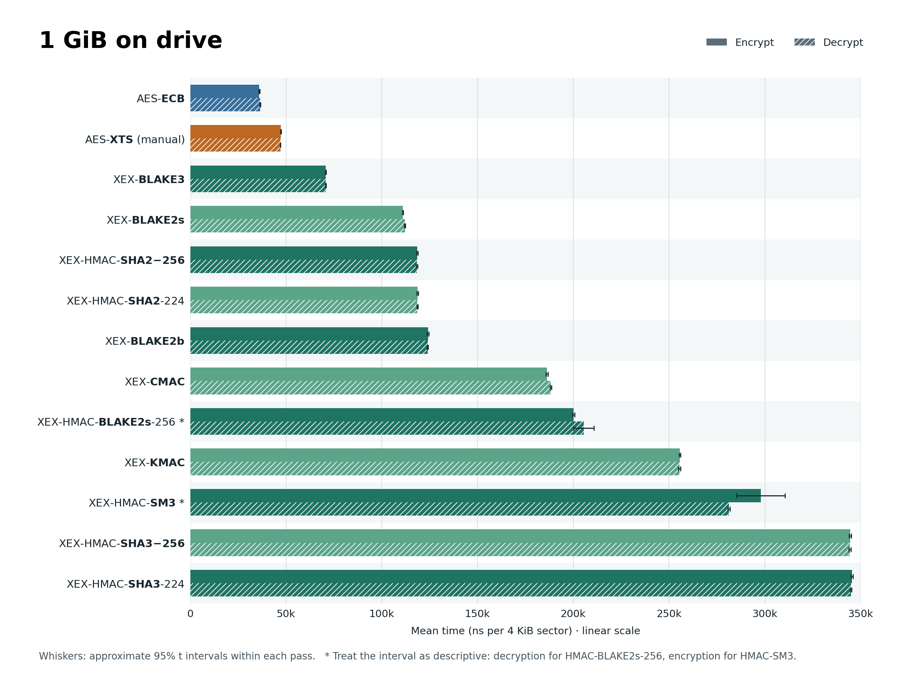
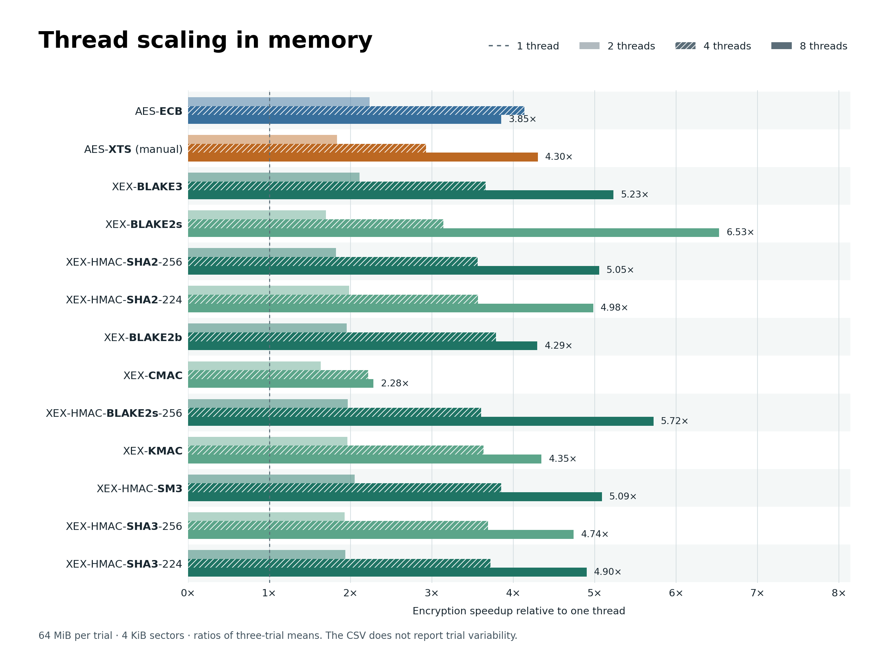

# Full-disk encryption benchmark results

Lower time per sector is better. Each row pairs **encryption** (solid) with **decryption** (hatched). Whiskers show 95% Student t intervals for arithmetic means.

## 1 GiB on drive

- **XEX-BLAKE3 was the fastest plotted XEX variant.** It took about **1.50×** as long per sector as manual AES-XTS in both directions. On encryption, that was **55.2 MiB/s** versus **82.7 MiB/s**. Time spent on reads and writes accounted for about 30% of BLAKE3's encryption pass and 45% of XTS's.
- **An asterisk flags serial dependence or drift.** Adjacent batches can remain fast or slow together, so treating them as independent can make a t interval too narrow. HMAC-BLAKE2s-256 decryption showed strong serial dependence, and HMAC-SM3 encryption averaged 12.7% more time per sector in the first half than in the second. Treat those two intervals as descriptive.

## 32 MiB in memory

- **BLAKE3 took 5.72× as long to encrypt in memory as manual AES-XTS**, versus 1.50× on drive. The drive measurements include I/O, which makes differences in cryptographic processing a smaller share of total time. BLAKE2s was the next fastest plotted XEX variant in both directions.

## Thread scaling in memory

Each trial encrypted **64 MiB** in **4 KiB sectors**, assigning disjoint ranges of sectors to 1, 2, 4 or 8 workers. Speedup is the one-thread mean time divided by the mean time at the indicated thread count. Each mean uses three trials; the CSV contains no trial-level times or dispersion, so the chart has no confidence intervals.

- At eight threads, **XEX-BLAKE2s had the largest relative speedup (6.53×)**, while **XEX-BLAKE3 remained the fastest plotted ratchet (631 MiB/s, 5.23×)**. Manual AES-XTS reached **3,263 MiB/s (4.30×)**. BLAKE3 scaled better relative to its own baseline but remained slower in absolute terms.
- This benchmark measures parallelism **across sectors**. XEX encryption still processes blocks in order within a sector. The scaling results apply to in-memory encryption and do not measure multithreaded disk I/O or decryption.

## Recorded latency results

All values are **means** ± 95% t interval half-width, in **ns per 4 KiB sector**. \* marks the two drive directions discussed above. The table also retains results for schemes omitted from the figures.

| Scheme | Drive encrypt | Drive decrypt | Memory encrypt | Memory decrypt |
|---|---:|---:|---:|---:|
| AES-ECB | **36,029** ± 207 | **36,525** ± 178 | **3,478** ± 768 | **4,049** ± 4 |
| AES-XTS (manual) | **47,234** ± 202 | **47,016** ± 105 | **5,086** ± 16 | **5,503** ± 21 |
| AES-XTS (OpenSSL) | — | — | **899** ± 15 | **888** ± 22 |
| XEX-SipHash | **62,534** ± 187 | **62,157** ± 197 | **21,623** ± 20 | **21,244** ± 37 |
| XEX-BLAKE3 | **70,725** ± 206 | **70,696** ± 165 | **29,104** ± 19 | **28,386** ± 49 |
| XEX-BLAKE2s | **110,932** ± 186 | **112,000** ± 301 | **67,092** ± 461 | **66,141** ± 422 |
| XEX-HMAC-SHA256 | **118,564** ± 383 | **118,297** ± 332 | **77,106** ± 221 | **76,576** ± 478 |
| XEX-HMAC-SHA2-224 | **118,704** ± 303 | **118,510** ± 285 | **76,775** ± 66 | **76,032** ± 250 |
| XEX-BLAKE2b | **124,076** ± 381 | **123,899** ± 274 | **81,571** ± 241 | **80,931** ± 405 |
| XEX-CMAC | **186,184** ± 581 | **188,204** ± 381 | **143,033** ± 667 | **150,267** ± 7,398 |
| XEX-HMAC-BLAKE2s-256 | **200,143** ± 531 | **205,432** ± 5,279 \* | **155,569** ± 803 | **158,796** ± 351 |
| XEX-KMAC | **255,619** ± 354 | **255,451** ± 566 | **209,422** ± 465 | **212,308** ± 116 |
| XEX-HMAC-RIPEMD160 | **259,382** ± 321 | **260,115** ± 290 | **214,372** ± 2,227 | **214,736** ± 440 |
| XEX-HMAC-SM3 | **297,899** ± 12,584 \* | **281,182** ± 543 | **232,480** ± 468 | **239,960** ± 3,522 |
| XEX-HMAC-SHA3-256 | **344,573** ± 528 | **344,367** ± 633 | **295,279** ± 523 | **294,109** ± 2,280 |
| XEX-HMAC-SHA3-224 | **345,402** ± 574 | **344,919** ± 421 | **296,073** ± 1,920 | **296,842** ± 836 |
| XEX-GHASH | **1,215,657** ± 1,146 | **1,215,707** ± 1,378 | **1,143,494** ± 6,408 | **1,137,948** ± 5,045 |

## How the intervals were calculated

- **Drive:** A 1 GiB pass contains 262,144 sectors of 4 KiB. Split the pass into 16 consecutive batches of 64 MiB (16,384 sectors each). For each batch, subtract its start timestamp from its end timestamp and divide by 16,384 to get its mean time per sector. Take the mean and sample SD $s$ **across those 16 batch means**. The plotted interval is the mean ± $t_{0.975,15}s/\sqrt{16}$. It is approximate because consecutive batches may be dependent, and it does not measure variation across independent passes. Timings include reads and writes but exclude the final `fsync`.
- **Memory:** Each of the five 32 MiB trials covers 8,192 sectors. Divide the recorded trial mean and sample SD by 8,192 to put both in ns/sector. The plotted interval is the mean ± $t_{0.975,4}s/\sqrt{5}$, assuming approximately normal, independent trial times.
- **Environment:** The archive records an AMD Ryzen 7 8845HS (16 logical CPUs), Linux 6.14, GCC 13.3 and OpenSSL 3.0.13. Results come from the supplied CSVs.
