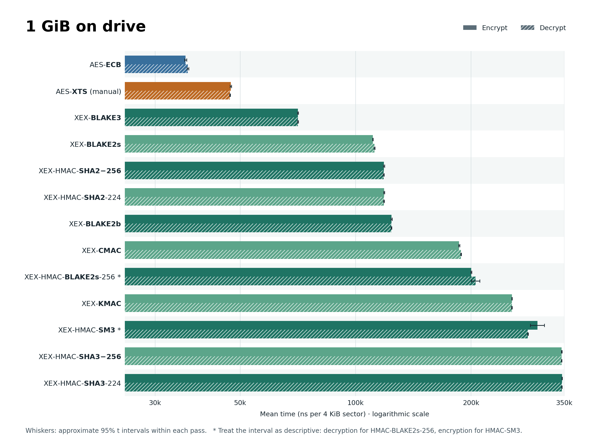
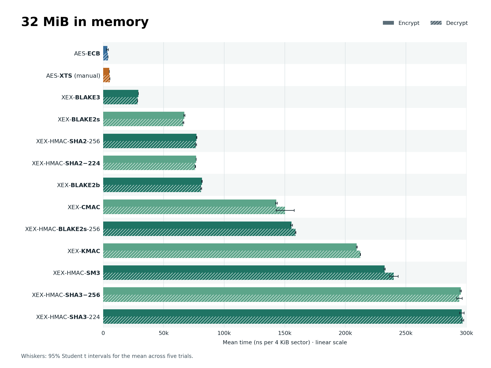
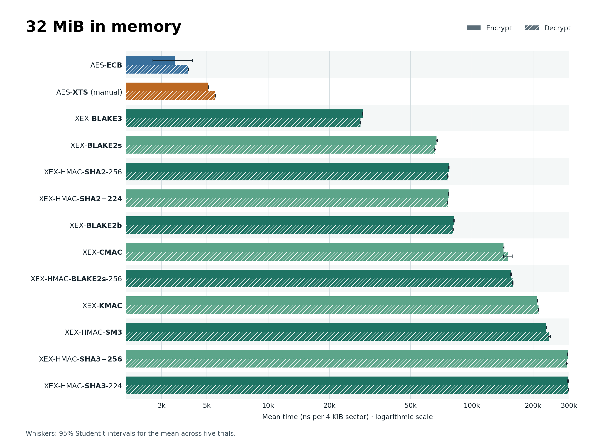

# Full-disk encryption benchmark results

Lower time per sector is better. Each row pairs **encryption** (solid) with **decryption** (hatched). Both scale versions use the same arithmetic means and 95% Student t whiskers. The linear charts show the absolute cost; the log charts separate the faster schemes.

## 1 GiB on drive

- **AES-ECB was fastest in both directions. XEX-SipHash was the fastest XEX variant.** It took about **1.32× as long per sector** as manual AES-XTS in both directions. XEX-BLAKE3 was next at about **1.50×**. For encryption, these correspond to **82.7 MiB/s** for manual XTS, **62.5 MiB/s** for SipHash and **55.2 MiB/s** for BLAKE3.
- **Most encrypt/decrypt means were close in these passes.** Two traces deserve caution: HMAC-SM3 encryption was uneven: its first half averaged **12.7% more time** than its second half, and HMAC-BLAKE2s-256 decryption had strong serial dependence. Their daggered whiskers are descriptive. Decrypting faster in one recorded pass does not establish an intrinsic advantage.
- **The drive workload includes I/O.** The recorded read/write timers accounted for about **45%** of manual XTS encryption time and **34%** of SipHash encryption time. Drive and memory ratios therefore measure different workloads.

## 32 MiB in memory

- **OpenSSL full-sector XTS was fastest in memory.** Manual XTS took **5.66× as long to encrypt** and **6.20× as long to decrypt**. The drive traces include only manual XTS, so the OpenSSL result cannot be used as a measured drive baseline.
- **SipHash and BLAKE3 also led the XEX variants in memory.** Their encryption costs were **4.25×** and **5.72×** manual XTS respectively. The bitwise GHASH implementation was the slowest in both workloads. That result describes this implementation, not hardware-accelerated GHASH. These figures compare performance only.

## Values behind the charts

All values are **means** ± 95% t interval half-width, in **ns per 4 KiB sector**. † marks drive traces with strong serial dependence or drift.

| Scheme | Drive encrypt | Drive decrypt | Memory encrypt | Memory decrypt |
|---|---:|---:|---:|---:|
| AES-ECB | **36,029** ± 207 | **36,525** ± 178 | **3,478** ± 768 | **4,049** ± 4 |
| AES-XTS (manual) | **47,234** ± 202 | **47,016** ± 105 | **5,086** ± 16 | **5,503** ± 21 |
| AES-XTS (OpenSSL) | — | — | **899** ± 15 | **888** ± 22 |
| XEX-SipHash | **62,534** ± 187 | **62,157** ± 197 | **21,623** ± 20 | **21,244** ± 37 |
| XEX-BLAKE3 | **70,725** ± 206 | **70,696** ± 165 | **29,104** ± 19 | **28,386** ± 49 |
| XEX-BLAKE2s | **110,932** ± 186 | **112,000** ± 301 | **67,092** ± 461 | **66,141** ± 422 |
| XEX-HMAC-SHA256 | **118,564** ± 383 | **118,297** ± 332 | **77,106** ± 221 | **76,576** ± 478 |
| XEX-HMAC-SHA2-224 | **118,704** ± 303 | **118,510** ± 285 | **76,775** ± 66 | **76,032** ± 250 |
| XEX-BLAKE2b | **124,076** ± 381 | **123,899** ± 274 | **81,571** ± 241 | **80,931** ± 405 |
| XEX-SHA3 (unkeyed) | **161,160** ± 481 | **161,661** ± 476 | **114,327** ± 332 | **116,906** ± 380 |
| XEX-CMAC | **186,184** ± 581 | **188,204** ± 381 | **143,033** ± 667 | **150,267** ± 7,398 |
| XEX-HMAC-BLAKE2s-256 | **200,143** ± 531 | **205,432** ± 5,279 † | **155,569** ± 803 | **158,796** ± 351 |
| XEX-KMAC | **255,619** ± 354 | **255,451** ± 566 | **209,422** ± 465 | **212,308** ± 116 |
| XEX-HMAC-RIPEMD160 | **259,382** ± 321 | **260,115** ± 290 | **214,372** ± 2,227 | **214,736** ± 440 |
| XEX-HMAC-SM3 | **297,899** ± 12,584 † | **281,182** ± 543 | **232,480** ± 468 | **239,960** ± 3,522 |
| XEX-HMAC-SHA3-256 | **344,573** ± 528 | **344,367** ± 633 | **295,279** ± 523 | **294,109** ± 2,280 |
| XEX-HMAC-SHA3-224 | **345,402** ± 574 | **344,919** ± 421 | **296,073** ± 1,920 | **296,842** ± 836 |
| XEX-GHASH | **1,215,657** ± 1,146 | **1,215,707** ± 1,378 | **1,143,494** ± 6,408 | **1,137,948** ± 5,045 |

## How the intervals were calculated

- **Drive:** One recorded pass per scheme and direction, with 512 progress intervals of 512 sectors. I used elapsed-time differences divided by the change in sector count, because the byte counter is one sector high. Each bar is the final recorded elapsed time divided by 262,144 sectors. It includes reads, cryptographic processing, writes and loop overhead, but excludes the final `fsync`. For each whisker, I grouped consecutive intervals into 16 equal 64 MiB batches and used $t_{0.975,15}s/\sqrt{16}$, with $s$ the sample SD of the batch means. This is an **approximate within-pass interval** assuming sufficiently independent, stable batch means. It does not estimate run-to-run uncertainty. Using 128 MiB batches instead increased the two daggered half-widths from about **12,584 to 20,432 ns** (SM3 encryption) and **5,279 to 8,454 ns** (HMAC-BLAKE2s-256 decryption).
- **Memory:** Five trials of 32 MiB per scheme and direction, each processing 8,192 sectors. I divided the recorded trial mean and sample SD by 8,192 and used $t_{0.975,4}s/\sqrt{5}$. This small-sample interval assumes approximately normal, independent trial times. Individual trial times were not provided.
- **Environment:** The archive records an AMD Ryzen 7 8845HS (16 logical CPUs), Linux 6.14, GCC 13.3 and OpenSSL 3.0.13. Results come from the supplied CSVs.
