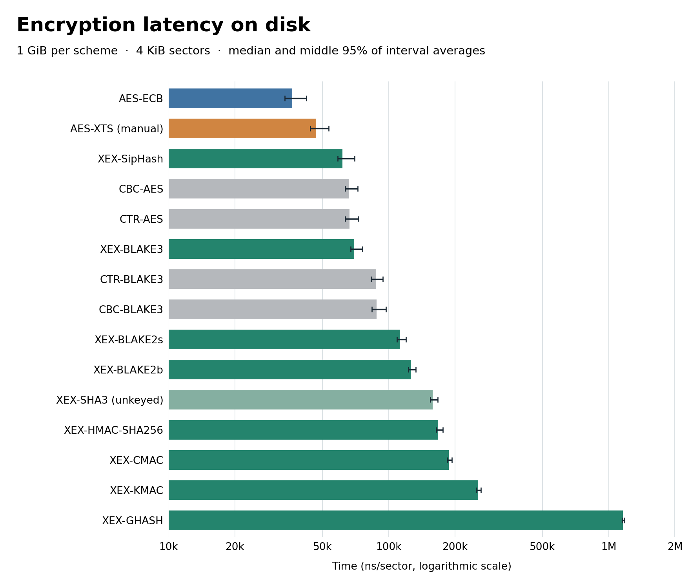
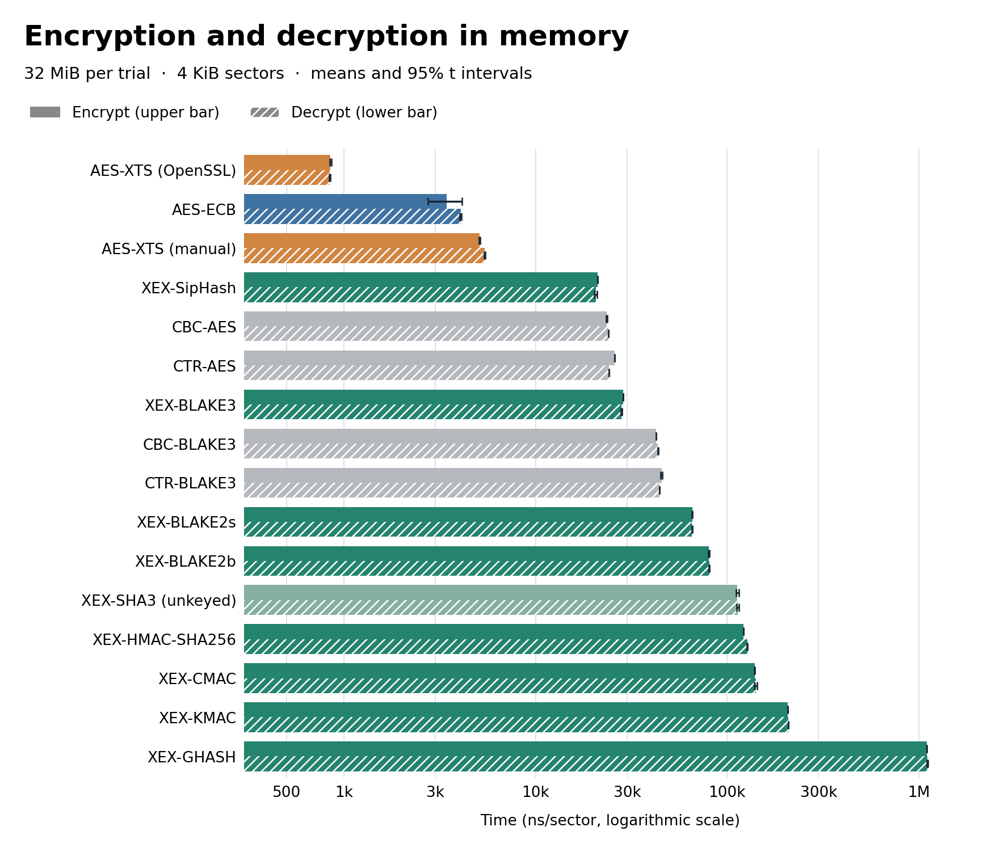

# Ratcheted full-disk encryption: drive measurements

On the recorded **1 GiB encryption pass**, AES-ECB was fastest, followed by manual AES-XTS. **XEX-SipHash was the fastest ratchet**: its median was 61,703 ns/sector, **32% more time per sector** than XTS (46,911 ns/sector). The archive contains no labelled drive decryption trace. The encrypt/decrypt comparison below therefore uses the separate in-memory benchmark.

## 1. Encryption on disk

Each CSV row is a progress checkpoint. Subtracting successive timestamps and dividing by the number of newly processed sectors gives **average ns/sector for that interval**. Each scheme has 512 intervals × 512 sectors × 4,096 bytes = 1 GiB. The bars show the **median of the 512 interval averages**, including reads, encryption, writes and loop overhead; the final `fsync` occurs after the last timestamp. Both charts use logarithmic axes: equal horizontal distances represent equal ratios. CTR and CBC are grey for reference.



| Scheme | Encrypt (ns/sector): median [P2.5–P97.5] |
|:--|--:|
| AES-ECB | **36,533** [33,749–42,333] |
| AES-XTS (manual) | **46,911** [44,114–53,457] |
| XEX-SipHash | **61,703** [58,711–70,090] |
| CBC-AES | **66,180** [63,414–72,376] |
| CTR-AES | **66,293** [63,508–73,086] |
| XEX-BLAKE3 | **69,808** [67,335–76,077] |
| CTR-BLAKE3 | **87,670** [83,075–94,161] |
| CBC-BLAKE3 | **88,294** [83,816–97,089] |
| XEX-BLAKE2s | **112,768** [109,185–120,014] |
| XEX-BLAKE2b | **126,595** [123,153–132,832] |
| XEX-SHA3 (unkeyed) | **158,471** [154,697–167,020] |
| XEX-HMAC-SHA256 | **167,601** [164,593–176,222] |
| XEX-CMAC | **187,310** [184,414–194,025] |
| XEX-KMAC | **255,382** [251,429–262,803] |
| XEX-GHASH | **1,162,991** [1,158,717–1,178,128] |

- CBC-AES and CTR-AES differed by less than 0.2% in median latency. Replacing their AES update with BLAKE3 raised latency by about one-third in both modes. Within XEX, BLAKE2s took about 11% less time per sector than BLAKE2b. GHASH used the bitwise reference implementation; its timing does not measure hardware-accelerated GHASH.
- Whiskers span the **2.5th to 97.5th percentiles** of the 512 observed interval averages. They describe how much latency varied during that pass. A CI for performance across runs would require independent repeated passes. The calculation uses sector counts because the logger’s cumulative byte counter is one sector too high.

## 2. Encrypt versus decrypt in memory

Each of five trials processed 32 MiB, or 8,192 sectors of 4 KiB. The table reports the **median trial time per sector**, followed by the sample standard deviation (SD) across trials. SD is spread, not a confidence interval. The chart uses **mean** bars and approximate 95% intervals for the mean ($t_4 s/\sqrt{5}$ on either side), assuming independent, approximately normal trial times. The five original timings were not retained, so there is no empirical 95% median interval to report.



| Scheme | Encrypt (ns/sector): median (SD) | Decrypt (ns/sector): median (SD) |
|:--|--:|--:|
| AES-XTS (OpenSSL) | **848** (SD 6) | **839** (SD 4) |
| AES-ECB | **3,182** (SD 556) | **4,076** (SD 36) |
| AES-XTS (manual) | **5,084** (SD 26) | **5,423** (SD 26) |
| XEX-SipHash | **21,087** (SD 12) | **20,451** (SD 261) |
| CBC-AES | **23,465** (SD 101) | **23,909** (SD 15) |
| CTR-AES | **25,764** (SD 4) | **24,185** (SD 26) |
| XEX-BLAKE3 | **28,587** (SD 25) | **27,923** (SD 201) |
| CBC-BLAKE3 | **42,515** (SD 42) | **43,496** (SD 62) |
| CTR-BLAKE3 | **45,243** (SD 376) | **44,276** (SD 53) |
| XEX-BLAKE2s | **65,632** (SD 71) | **65,477** (SD 224) |
| XEX-BLAKE2b | **80,148** (SD 306) | **80,589** (SD 102) |
| XEX-SHA3 (unkeyed) | **112,274** (SD 1,353) | **113,200** (SD 1,181) |
| XEX-HMAC-SHA256 | **121,669** (SD 138) | **127,174** (SD 205) |
| XEX-CMAC | **139,031** (SD 327) | **142,315** (SD 2,018) |
| XEX-KMAC | **207,278** (SD 271) | **208,473** (SD 57) |
| XEX-GHASH | **1,102,646** (SD 1,224) | **1,104,570** (SD 5,213) |

Decryption was not uniformly faster: manual XTS took about 7% longer to decrypt than encrypt, whereas CTR-AES took about 6% less time. OpenSSL full-sector XTS took about one-sixth of manual XTS’s time to encrypt in memory. Only the manual path appears in the labelled drive traces.

## 3. Where the 500 iterations apply

[`component_breakdown.csv`](results/component_breakdown.csv) totals 500 **whole-sector calls** per scheme and direction, each on one 4 KiB sector (256 AES blocks). Divide `outer_total_ns` by 500 for the mean ns/sector; divide a per-block component’s accumulated time by 128,000 for its amortised ns/block. These totals cannot recover individual block timings, a median or a confidence interval.

## 4. Reproduce the figures

The archived environment record lists an AMD Ryzen 7 8845HS, Linux 6.14 (x86-64), GCC 13.3 and OpenSSL 3.0.13. From the project directory, the following commands read the existing CSVs and write the two PNGs into `figures/`. No drive access is needed.

```sh
python -m pip install numpy matplotlib
python scripts/report_figures.py
```

For the Linux drive utility, `make test-drive` **without** a device argument builds the binary only. Its syntax is:

```text
build/fde_test_drive [--scheme NAME] encrypt|decrypt DEVICE [offset_bytes] [count_bytes] [csv_path] [direct]
```

The drive utility overwrites the selected range in place; its zero count means “to the end of the device”. The [multi-scheme runner](scripts/run_drive_schemes.sh) records one direction per invocation. [Detailed component and scaling results](RESULTS.md) are included in the original project.
