# FDE King 1 — results on Intel i7 and Xeon

Six fresh-process launches per experiment group on each CPU; four groups per CPU. All 15 correctness tests passed in every group. Tables and bar charts below use the same CSVs in [`/figures-0/tables/`](/figures-0/tables/). Click any embedded image to open it at full size.

## 1. Methodology and research questions

| RQ | Measured procedure per CPU |
| --- | --- |
| RQ1 — Component cost | 500 instrumented 4 KiB encryptions and decryptions per construction per launch; 20 engine setups; 10 paired reference/optimized trials of 50 sectors. |
| RQ2 — Throughput and latency | Five timed 1 MiB passes per condition per launch; 512-byte and 4096-byte sectors. A separate seven-profile study processes 1 and 4 MiB within the same launches. |
| RQ3 — Hash/mask choice | Ten batches of 10,000 calls per profile per launch; 48-byte input, 16-byte output. Both independent prebuilt contexts and feedback contexts are measured. |
| RQ4 — Reads, threading and recovery | 200 reads at six block positions; five trials with 1, 2 and 4 workers at 256 and 1024 KiB; eight within-sector decryptions per trial; errors at blocks 1, 32 and 256. |

- A 64 MiB RAM image is allocated. The 1/4 MiB setting is bytes processed per timed pass, not total process memory. Key/pool setup, fixture construction, warm-up and CSV writes are outside steady-state timings; worker dispatch/joins are included. Condition order is randomized. No disk I/O or GPU/CUDA is timed.
- **Point estimate:** the median of the six per-launch medians. Speedup is computed within each launch, then summarized; consequently a reported speedup need not equal the quotient of two displayed medians.
- **Error bars:** the same conservative **95% confidence criterion** is used for both CPUs. For six independent, comparable launches, the distribution-free median interval uses the smallest and largest launch medians. Its actual coverage is $1-2(1/2)^6=96.875\%$: excluding the true median requires all six observations to fall strictly on one side. Thus 96.875% came from the available sample size, not a selected plotting preference.[^stats] Figures label these as conservative 95% CIs. Their widths are retained; reducing confidence only for Xeon would change the comparison rather than improve the measurements.
- Confidence intervals are pointwise, not corrected for all comparisons, and depend on launch comparability/independence. Within-launch repetitions are not additional independent launches. A speedup interval entirely above 1 supports an improvement; a ±5% equivalence claim requires the entire interval inside $[0.95,1.05]$.
- $q=\mathrm{MiB/s}=\mathrm{bytes}/(2^{20}t)$, $\mathrm{ns/byte}=10^9/(2^{20}q)$, and $\mathrm{ns/sector}=B\,\mathrm{ns/byte}$. These are amortized processing costs, not storage-tail latencies. Thread speedup is $S(p)=q_p/q_1$; efficiency is $100S(p)/p\%$, not measured CPU utilization. Cycles were not measured.

## 2. Environment and assumptions

| Variable | Intel i7 | Xeon |
| --- | --- | --- |
| CPU | 13th Gen Intel(R) Core(TM) i7-1365U | INTEL(R) XEON(R) PLATINUM 8573C |
| OS | Linux-6.18.58.1-microsoft-standard-WSL2-x86_64-with-glibc2.43 | Linux-6.18.57-x86_64-with-glibc2.41 |
| Python / GIL | 3.14.4 / enabled | 3.12.14 / enabled |
| Exposed logical CPUs / affinity | 12 / 12 | 9 / 9 |
| Active calling / worker threads | RQ1–3: 1; RQ4: 1, 2, 4 | RQ1–3: 1; RQ4: 1, 2, 4 |
| AES-NI / CLMUL available | Yes / yes | Yes / yes |
| Backend | OpenSSL 4.0.1 9 Jun 2026 | OpenSSL 4.0.1 9 Jun 2026 |
| Execution | CPU only; perf_counter_ns | CPU only; perf_counter_ns |
| Frequency, power, load | Uncontrolled; frequency not exposed | Uncontrolled; frequency not exposed |

- Both use `cryptography 50.0.0`, `pycryptodome 4.5.0`, `blake3 1.0.11`, `PyNaCl 1.6.2`, `numpy 2.3.5`, `pandas 2.2.3` and `matplotlib 3.10.8`. Recorded implementation hashes match. Startup prints these conditions; per-launch snapshots are retained in each run's `[RAW]/`. Threads are unpinned. Matching versions do not guarantee identical binary builds or CPU dispatch.
- **AES-256 has 16-byte blocks**: a 4 KiB sector contains $n=256$. Data and XTS/CBC-MAC mask keys are 256 bits. A public 64-byte benchmark fixture supplies the two key halves; SipHash/LRW use the first 16 bytes of the mask-key half. No padding, ciphertext stealing or authentication tag is implemented.
- All feedback profiles use $C_j=E_{K_2}(P_j\oplus\Delta_j)\oplus\Delta_j$. Hash-XEX uses a keyed hash of $S\parallel I_j\parallel C_{j-1}$; each field is 16 bytes, indices start at zero, and initial feedback is zero. AES-MAC-CBC and LRW are separate profile families. The feedback LRW proposal is distinct from standardized LRW encryption.
- Both manual-XTS controls build tweaks in Python and batch data AES/XORs; their AES-NI flag differs. OpenSSL XTS processes the sector inside its native mode. AES-NI is requested elsewhere; LRW uses the pinned native GHASH adapter with tested coefficient-bit conversion. Actual assembly selection was not traced.[^aes]
- The bundled verification folder `results-lrw-final` and smoke folder `results-check` are excluded. Performance and error propagation do not establish cryptographic security.

## 3. Run in a terminal

1. Open `fde-king-1` in VS Code and use Python 3.12 or newer.
2. Create a virtual environment: `python -m venv .venv` (Windows: `py -3 -m venv .venv`).
3. Activate: Linux/macOS `source .venv/bin/activate`; Windows PowerShell `.venv\Scripts\Activate.ps1`.
4. Install: `python -m pip install -r requirements.txt`. Check: `python -m unittest discover -s tests -v`.
5. Run the measured study below. Change the `--name` suffix when its result folder already exists. Both executed OS environments are Linux, including WSL2; native Windows/macOS execution is not claimed.

```bash
python run.py --name components --rqs 1 3 --sessions 6 --profile-rounds 500 --hash-calls 10000
python run.py --name throughput --rqs 2 --sessions 6 --work-mib 1 --repeats 5
python run.py --name worksets --rqs 2 --sessions 6 --work-mib 1 4 --repeats 5 --schemes ecb_bulk xts_library xts_manual_ni xex_blake2s cbc_mac lrw_horner lrw_precompute
python run.py --name parallel --rqs 4 --sessions 6 --workers 1 2 4 --thread-kib 256 1024 --thread-repeats 5 --schemes ecb_bulk xts_library xts_manual_ni xex_blake2s cbc_mac lrw_horner lrw_precompute
```

6. Each command creates one `results-<name>/` containing `[RAW]/`, `[FIGURES]/`, CSVs, settings/logs and `README.txt`; it creates no Markdown report. Reanalyse without remeasuring: `python run.py --analyse results-worksets`.
7. The default full-encryption hash is selected by `DEFAULT_MASK = 'blake2s'` in `fdebench/engine.py`; explicit selection is `Engine('xex', 'blake3', key=...)`. See `example.py`.

Place this `README.md` in the repository root and extract `figures-0.zip` beside it. Embedded images use relative paths for local Markdown preview; clicking an image opens `/figures-0/...png` in the repository. CSV links use `/figures-0/tables/...`. Automatic per-run figures remain in each run's `[FIGURES]/`.

## 4. Results, interpretation and justification

### RQ1 — Component cost and optimization

**Encryption/decryption component shares (%).** E = encryption; D = decryption. Values include Python/native wrappers and instrumentation. OpenSSL data/library cost is opaque; its seed/mask split is unavailable. Separately estimated medians need not sum to exactly 100%.

#### Intel i7 — component shares

| Construction | Op. | Seed % | Mask/tweak % | Data/library % | Other % |
| --- | --- | --- | --- | --- | --- |
| AES-ECB | E | 0.00 | 0.00 | 96.24 | 3.76 |
| AES-ECB | D | 0.00 | 0.00 | 96.44 | 3.56 |
| AES-XTS, OpenSSL | E | — | — | 99.20 | 0.80 |
| AES-XTS, OpenSSL | D | — | — | 99.19 | 0.81 |
| AES-XTS, manual AES-NI | E | 3.29 | 83.61 | 12.16 | 0.75 |
| AES-XTS, manual AES-NI | D | 3.31 | 83.41 | 12.39 | 0.76 |
| AES-XTS, manual NI off | E | 3.33 | 72.52 | 23.36 | 0.66 |
| AES-XTS, manual NI off | D | 3.28 | 72.06 | 23.86 | 0.67 |
| XEX–BLAKE2s | E | 0.05 | 19.22 | 74.08 | 6.62 |
| XEX–BLAKE2s | D | 0.25 | 92.79 | 6.22 | 0.70 |
| XEX–BLAKE2b | E | 0.05 | 21.46 | 72.07 | 6.39 |
| XEX–BLAKE2b | D | 0.21 | 93.65 | 5.49 | 0.59 |
| XEX–BLAKE3 | E | 0.04 | 21.57 | 71.99 | 6.31 |
| XEX–BLAKE3 | D | 0.20 | 93.40 | 5.76 | 0.60 |
| XEX–SipHash-128 | E | 0.04 | 29.65 | 64.42 | 5.80 |
| XEX–SipHash-128 | D | 0.15 | 95.57 | 3.82 | 0.42 |
| XEX–KMAC128 | E | 0.01 | 78.50 | 19.60 | 1.87 |
| XEX–KMAC128 | D | 0.01 | 99.52 | 0.41 | 0.05 |
| AES-MAC-CBC | E | 0.25 | 43.48 | 51.26 | 4.84 |
| AES-MAC-CBC | D | 12.01 | 54.14 | 29.16 | 4.23 |
| LRW-Horner | E | 0.03 | 47.09 | 48.33 | 4.44 |
| LRW-Horner | D | 0.07 | 98.00 | 1.72 | 0.19 |
| LRW-precompute | E | 0.44 | 41.47 | 53.06 | 4.88 |
| LRW-precompute | D | 1.03 | 96.59 | 2.08 | 0.26 |

#### Xeon — component shares

| Construction | Op. | Seed % | Mask/tweak % | Data/library % | Other % |
| --- | --- | --- | --- | --- | --- |
| AES-ECB | E | 0.00 | 0.00 | 96.49 | 3.51 |
| AES-ECB | D | 0.00 | 0.00 | 96.62 | 3.38 |
| AES-XTS, OpenSSL | E | — | — | 99.05 | 0.95 |
| AES-XTS, OpenSSL | D | — | — | 99.06 | 0.94 |
| AES-XTS, manual AES-NI | E | 3.31 | 83.70 | 11.91 | 0.70 |
| AES-XTS, manual AES-NI | D | 3.31 | 83.49 | 12.11 | 0.70 |
| AES-XTS, manual NI off | E | 3.27 | 72.37 | 23.37 | 0.59 |
| AES-XTS, manual NI off | D | 3.24 | 72.20 | 23.51 | 0.60 |
| XEX–BLAKE2s | E | 0.06 | 14.51 | 78.20 | 6.28 |
| XEX–BLAKE2s | D | 0.38 | 91.53 | 7.31 | 0.71 |
| XEX–BLAKE2b | E | 0.05 | 16.71 | 76.13 | 6.14 |
| XEX–BLAKE2b | D | 0.33 | 92.52 | 6.44 | 0.63 |
| XEX–BLAKE3 | E | 0.05 | 19.96 | 73.44 | 5.69 |
| XEX–BLAKE3 | D | 0.29 | 93.21 | 5.87 | 0.55 |
| XEX–SipHash-128 | E | 0.04 | 28.97 | 64.79 | 5.27 |
| XEX–SipHash-128 | D | 0.18 | 95.92 | 3.54 | 0.33 |
| XEX–KMAC128 | E | 0.01 | 78.48 | 19.41 | 1.69 |
| XEX–KMAC128 | D | 0.02 | 99.58 | 0.36 | 0.04 |
| AES-MAC-CBC | E | 0.21 | 43.49 | 50.92 | 4.36 |
| AES-MAC-CBC | D | 12.09 | 54.69 | 28.76 | 3.56 |
| LRW-Horner | E | 0.04 | 43.49 | 51.39 | 4.33 |
| LRW-Horner | D | 0.08 | 98.08 | 1.67 | 0.16 |
| LRW-precompute | E | 0.38 | 38.48 | 55.55 | 4.54 |
| LRW-precompute | D | 0.97 | 96.80 | 1.95 | 0.22 |

[CSV: rq1_components](/figures-0/tables/rq1_components.csv) · [CSV: rq1_component_ns](/figures-0/tables/rq1_component_ns.csv)

[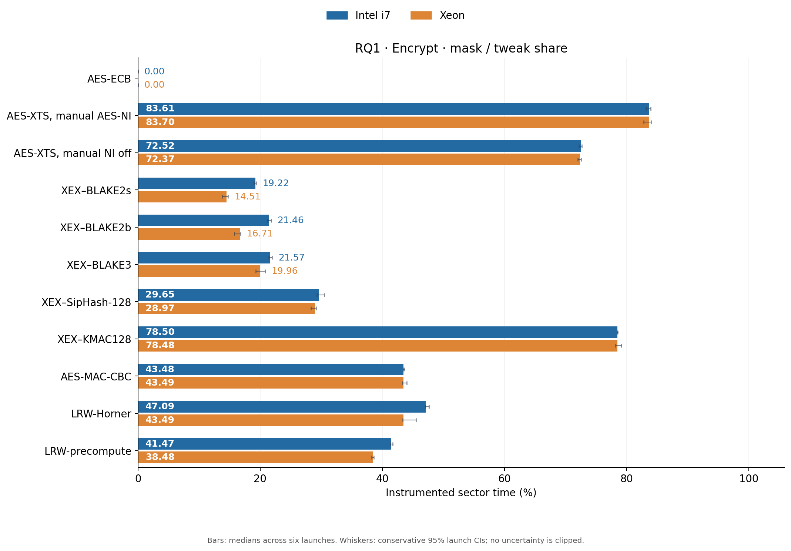](/figures-0/rq1_components_encrypt.png)

[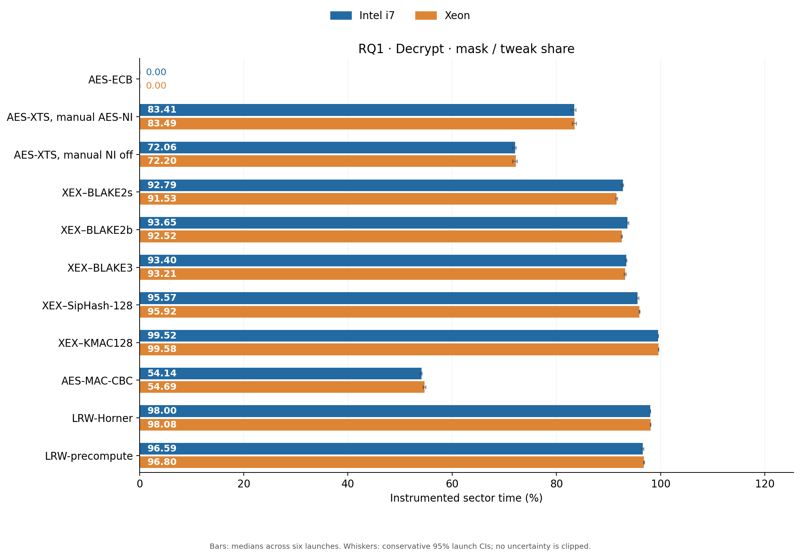](/figures-0/rq1_components_decrypt.png)

**Optimized schedule versus reference block loop.** Speedup = reference time / optimized time. This comparison shares the mask adapters and is separate from precompute versus Horner.

| Construction | Intel i7 E | Intel i7 D | Xeon E | Xeon D |
| --- | --- | --- | --- | --- |
| AES-ECB | 0.847× | 0.838× | 0.868× | 0.851× |
| AES-XTS, OpenSSL | 0.903× | 0.895× | 0.630× | 0.891× |
| AES-XTS, manual AES-NI | 7.585× | 7.545× | 8.299× | 8.077× |
| AES-XTS, manual NI off | 6.676× | 6.685× | 7.662× | 7.417× |
| XEX–BLAKE2s | 0.988× | 4.807× | 0.991× | 6.293× |
| XEX–BLAKE2b | 0.986× | 4.308× | 0.997× | 5.453× |
| XEX–BLAKE3 | 0.993× | 4.906× | 1.035× | 5.641× |
| XEX–SipHash-128 | 0.982× | 3.340× | 1.064× | 3.621× |
| XEX–KMAC128 | 0.993× | 1.249× | 0.998× | 1.238× |
| AES-MAC-CBC | 1.389× | 78.465× | 1.396× | 92.449× |
| LRW-Horner | 0.982× | 2.050× | 0.977× | 2.221× |
| LRW-precompute | 1.122× | 2.477× | 1.153× | 2.615× |

[CSV: rq1_optimization](/figures-0/tables/rq1_optimization.csv)

[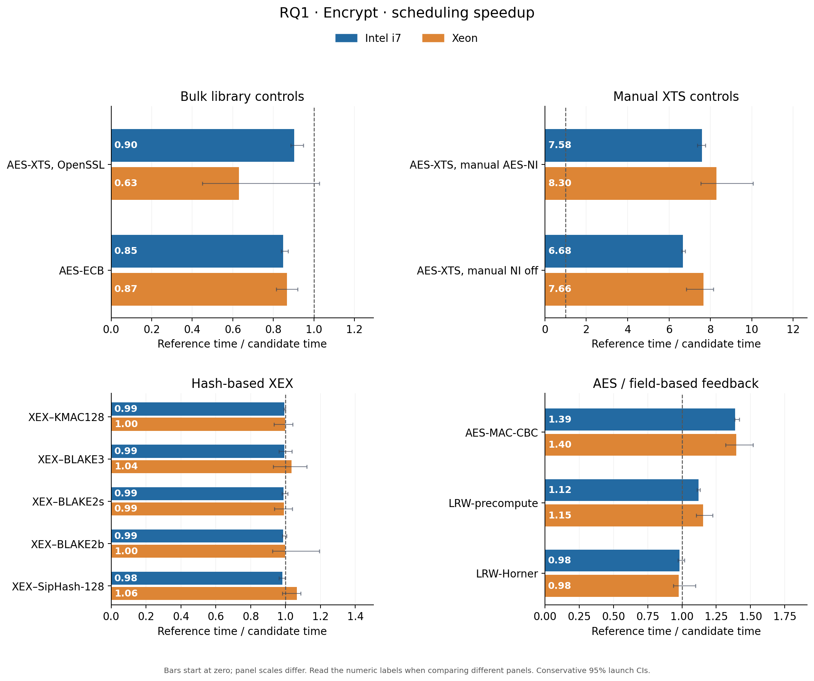](/figures-0/rq1_optimization_encrypt.png)

[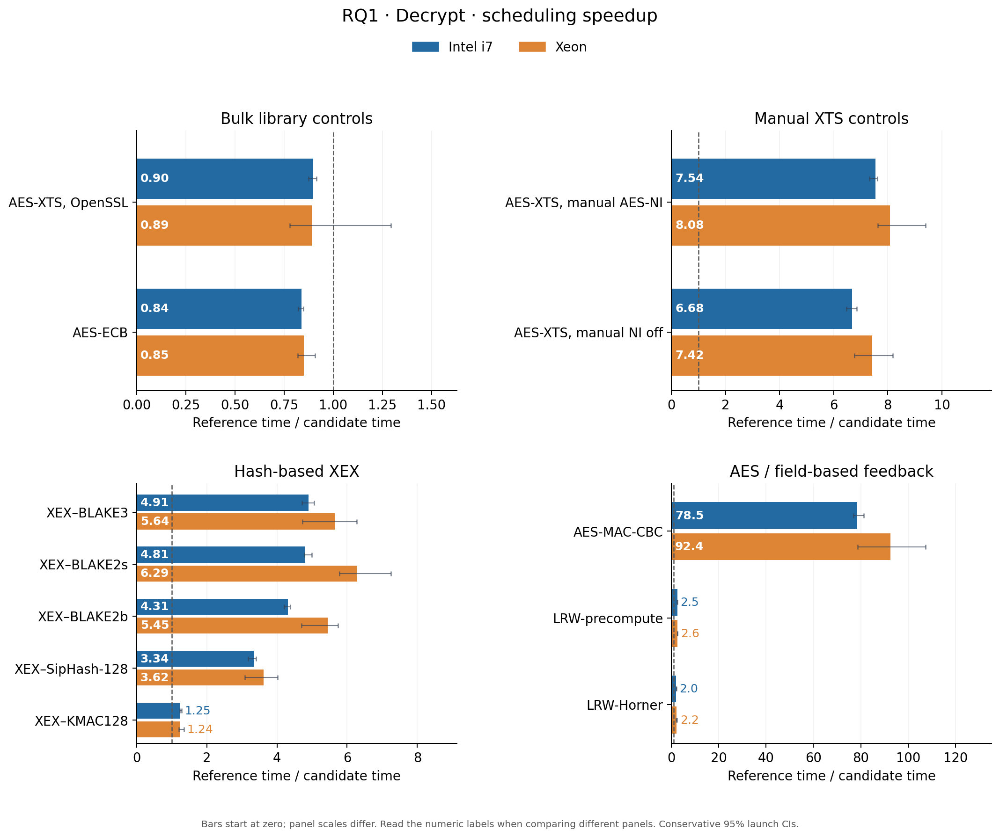](/figures-0/rq1_optimization_decrypt.png)

**Full-engine setup costs.** Key/table setup is excluded from steady-state throughput and measured here. Position-table bytes exclude Python objects/native contexts.

| Construction | Intel i7 µs/setup | Xeon µs/setup | Position-table bytes |
| --- | --- | --- | --- |
| AES-ECB | 6.43 | 11.29 | 0 |
| AES-XTS, OpenSSL | 6.21 | 11.37 | 0 |
| AES-XTS, manual AES-NI | 6.31 | 11.21 | 0 |
| AES-XTS, manual NI off | 6.88 | 12.19 | 0 |
| XEX–BLAKE2s | 7.39 | 13.05 | 0 |
| XEX–BLAKE2b | 7.36 | 13.11 | 0 |
| XEX–BLAKE3 | 7.60 | 14.06 | 0 |
| XEX–SipHash-128 | 6.79 | 11.95 | 0 |
| XEX–KMAC128 | 6.85 | 12.21 | 0 |
| AES-MAC-CBC | 9.48 | 17.00 | 0 |
| LRW-Horner | 9.13 | 16.44 | 0 |
| LRW-precompute | 296.35 | 557.20 | 4096 |

[CSV: rq1_setup](/figures-0/tables/rq1_setup.csv)

**Findings and explanation**

- Seeding is below 0.5% for the feedback profiles. Manual XTS spends about **84% of profiled encryption time in Python tweak generation**, on both CPUs. Its optimized schedule is **7.58 [7.37, 7.76]×** faster on Intel i7 and **8.30 [7.54, 10.06]×** on Xeon, because data AES/XORs are batched.
- BLAKE2s spends about **74% / 78%** of profiled encryption time in the data path on Intel i7 / Xeon. That includes XORs, slicing, output writes and AES wrapper calls. KMAC128 instead spends about **78% in masks**. The next useful optimization differs: reduce data-path overhead for BLAKE2s, mask-adapter overhead for KMAC.
- AES-MAC-CBC decryption improves by **78.47 [76.94, 81.27]×** and **92.45 [78.62, 107.36]×** against its reference loop. It batches the mask stages and data AES. BLAKE2s/Horner encryption intervals include 1 on both CPUs, so their scheduling changes establish no encryption gain.
- All sector paths perform $O(n)$ cryptographic work for $n$ blocks. The differences are constant factors, call granularity and encryption dependencies; two sector sizes alone do not establish a fitted timing law.

### RQ2 — Raw throughput and amortized latency

**Sector sizes are 512 bytes and 4096 bytes, not 512 KiB.** The all-profile throughput experiment processes **1 MiB per timed pass**. Each table descends by encryption throughput for that CPU. E/D = encryption/decryption; latency is derived from the same throughput estimator.

#### 512-byte sectors — complete throughput and latency tables

**Intel i7**

| Construction | E MiB/s | D MiB/s | E ns/sector | D ns/sector | E ns/byte | D ns/byte |
| --- | --- | --- | --- | --- | --- | --- |
| AES-ECB | 251.86 | 249.55 | 1,939 | 1,957 | 3.79 | 3.82 |
| AES-XTS, OpenSSL | 141.36 | 148.03 | 3,454 | 3,298 | 6.75 | 6.44 |
| AES-XTS, manual AES-NI | 33.44 | 32.90 | 14,601 | 14,841 | 28.52 | 28.99 |
| AES-XTS, manual NI off | 30.20 | 30.52 | 16,167 | 15,997 | 31.58 | 31.24 |
| XEX–BLAKE2s | 6.81 | 24.49 | 71,710 | 19,934 | 140.06 | 38.93 |
| XEX–BLAKE2b | 6.47 | 22.02 | 75,497 | 22,170 | 147.46 | 43.30 |
| XEX–BLAKE3 | 6.09 | 22.78 | 80,147 | 21,432 | 156.54 | 41.86 |
| XEX–SipHash-128 | 5.62 | 15.74 | 86,809 | 31,019 | 169.55 | 60.58 |
| LRW-precompute | 4.62 | 9.12 | 105,724 | 53,559 | 206.49 | 104.61 |
| AES-MAC-CBC | 4.50 | 40.72 | 108,570 | 11,992 | 212.05 | 23.42 |
| LRW-Horner | 4.16 | 7.91 | 117,515 | 61,747 | 229.52 | 120.60 |
| XEX–KMAC128 | 1.58 | 1.95 | 309,331 | 249,803 | 604.16 | 487.90 |

**Xeon**

| Construction | E MiB/s | D MiB/s | E ns/sector | D ns/sector | E ns/byte | D ns/byte |
| --- | --- | --- | --- | --- | --- | --- |
| AES-ECB | 119.39 | 111.01 | 4,090 | 4,398 | 7.99 | 8.59 |
| AES-XTS, OpenSSL | 70.40 | 61.79 | 6,936 | 7,902 | 13.55 | 15.43 |
| AES-XTS, manual AES-NI | 16.95 | 15.14 | 28,812 | 32,241 | 56.27 | 62.97 |
| AES-XTS, manual NI off | 15.36 | 14.61 | 31,796 | 33,423 | 62.10 | 65.28 |
| XEX–BLAKE2s | 3.23 | 13.54 | 151,320 | 36,052 | 295.55 | 70.41 |
| XEX–BLAKE2b | 3.10 | 12.37 | 157,681 | 39,488 | 307.97 | 77.12 |
| XEX–BLAKE3 | 2.84 | 11.44 | 171,744 | 42,690 | 335.44 | 83.38 |
| XEX–SipHash-128 | 2.56 | 7.23 | 190,636 | 67,516 | 372.34 | 131.87 |
| LRW-precompute | 2.26 | 4.54 | 215,891 | 107,447 | 421.66 | 209.86 |
| AES-MAC-CBC | 2.08 | 18.78 | 234,957 | 25,994 | 458.90 | 50.77 |
| LRW-Horner | 1.89 | 3.92 | 258,670 | 124,428 | 505.21 | 243.02 |
| XEX–KMAC128 | 0.71 | 0.88 | 690,814 | 553,084 | 1,349.25 | 1,080.24 |

[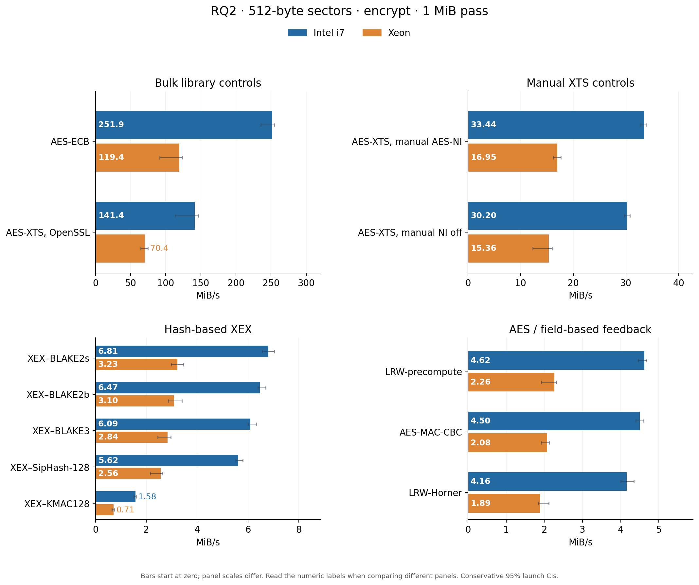](/figures-0/rq2_512_encrypt.png)

[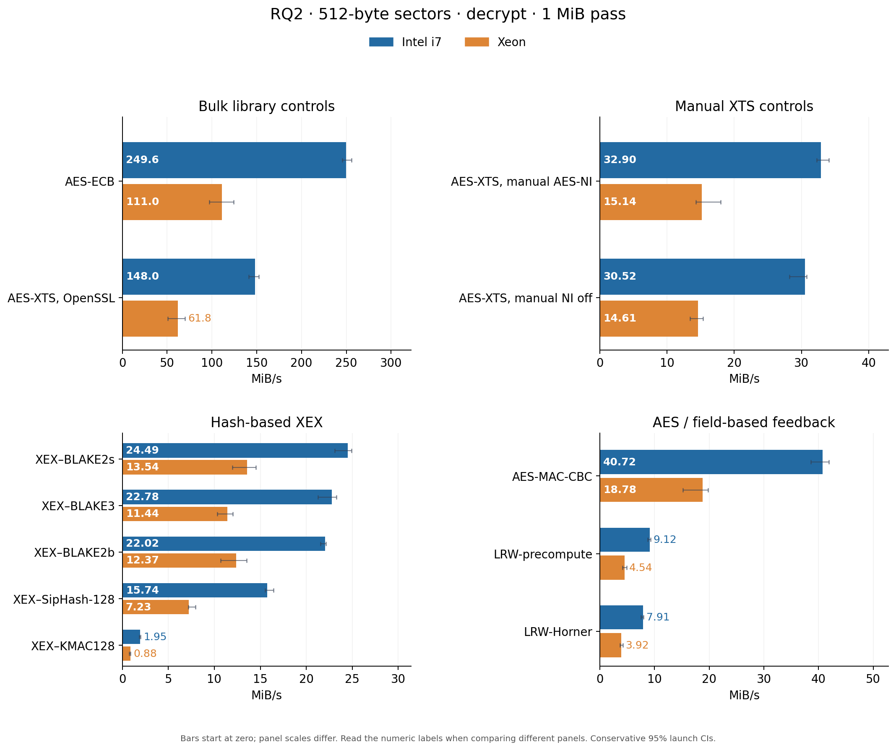](/figures-0/rq2_512_decrypt.png)

#### 4,096-byte sectors — complete throughput and latency tables

**Intel i7**

| Construction | E MiB/s | D MiB/s | E ns/sector | D ns/sector | E ns/byte | D ns/byte |
| --- | --- | --- | --- | --- | --- | --- |
| AES-ECB | 1,188.81 | 1,257.27 | 3,286 | 3,107 | 0.80 | 0.76 |
| AES-XTS, OpenSSL | 845.43 | 858.34 | 4,620 | 4,551 | 1.13 | 1.11 |
| AES-XTS, manual AES-NI | 55.39 | 55.48 | 70,519 | 70,403 | 17.22 | 17.19 |
| AES-XTS, manual NI off | 48.42 | 48.29 | 80,679 | 80,889 | 19.70 | 19.75 |
| XEX–BLAKE2s | 6.88 | 32.10 | 567,425 | 121,694 | 138.53 | 29.71 |
| XEX–BLAKE2b | 6.63 | 27.89 | 588,897 | 140,083 | 143.77 | 34.20 |
| XEX–BLAKE3 | 6.18 | 29.51 | 631,791 | 132,359 | 154.25 | 32.31 |
| XEX–SipHash-128 | 5.63 | 18.90 | 693,794 | 206,662 | 169.38 | 50.45 |
| LRW-precompute | 4.70 | 10.35 | 830,466 | 377,297 | 202.75 | 92.11 |
| AES-MAC-CBC | 4.68 | 257.31 | 835,507 | 15,181 | 203.98 | 3.71 |
| LRW-Horner | 4.24 | 8.47 | 921,342 | 461,243 | 224.94 | 112.61 |
| XEX–KMAC128 | 1.59 | 2.00 | 2,449,124 | 1,952,827 | 597.93 | 476.76 |

**Xeon**

| Construction | E MiB/s | D MiB/s | E ns/sector | D ns/sector | E ns/byte | D ns/byte |
| --- | --- | --- | --- | --- | --- | --- |
| AES-ECB | 696.00 | 666.72 | 5,612 | 5,859 | 1.37 | 1.43 |
| AES-XTS, OpenSSL | 447.19 | 442.66 | 8,735 | 8,825 | 2.13 | 2.15 |
| AES-XTS, manual AES-NI | 28.13 | 28.61 | 138,872 | 136,550 | 33.90 | 33.34 |
| AES-XTS, manual NI off | 24.11 | 24.51 | 162,026 | 159,396 | 39.56 | 38.91 |
| XEX–BLAKE2s | 3.40 | 19.66 | 1,147,626 | 198,700 | 280.18 | 48.51 |
| XEX–BLAKE2b | 3.35 | 17.42 | 1,166,707 | 224,234 | 284.84 | 54.74 |
| XEX–BLAKE3 | 2.88 | 14.75 | 1,358,518 | 264,845 | 331.67 | 64.66 |
| XEX–SipHash-128 | 2.51 | 9.21 | 1,555,875 | 424,199 | 379.85 | 103.56 |
| LRW-precompute | 2.28 | 5.03 | 1,714,178 | 777,156 | 418.50 | 189.74 |
| AES-MAC-CBC | 2.09 | 117.13 | 1,865,686 | 33,349 | 455.49 | 8.14 |
| LRW-Horner | 1.98 | 4.21 | 1,977,236 | 927,853 | 482.72 | 226.53 |
| XEX–KMAC128 | 0.71 | 0.90 | 5,517,493 | 4,354,984 | 1,347.04 | 1,063.23 |

[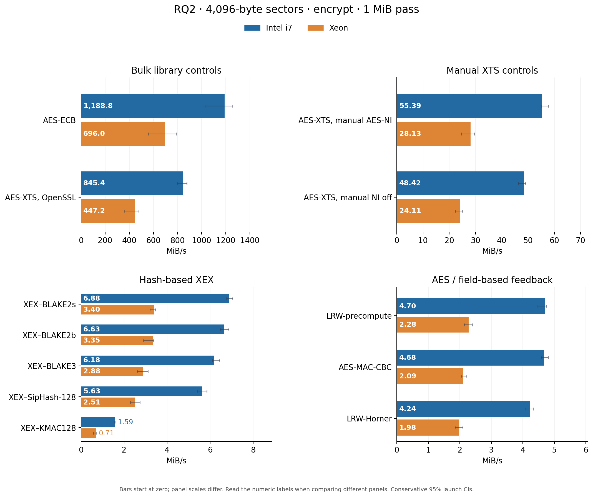](/figures-0/rq2_4096_encrypt.png)

[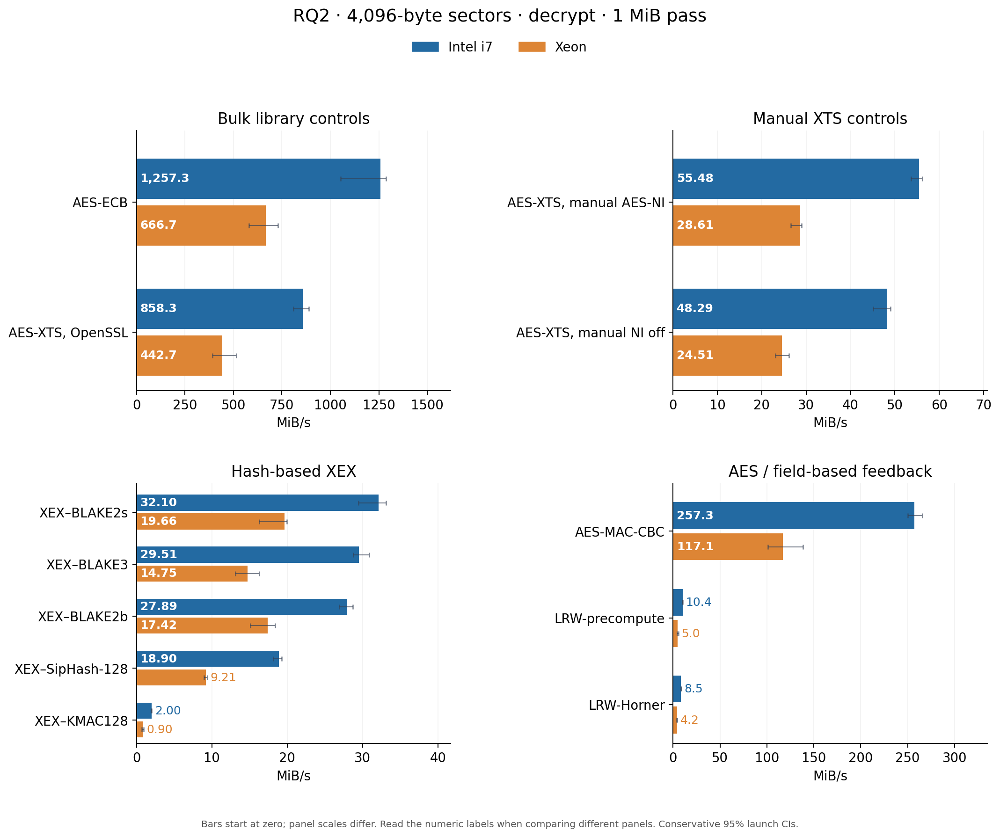](/figures-0/rq2_4096_decrypt.png)

[CSV: rq2_throughput](/figures-0/tables/rq2_throughput.csv) · [CSV: rq2_comparisons](/figures-0/tables/rq2_comparisons.csv)

Bar-chart panels use different **linear** scales to keep all families readable; every bar starts at zero. Use the printed values to compare different panels.

#### What is fastest, and why?

- **OpenSSL XTS is the fastest XTS path.** At 4 KiB it exceeds manual AES-NI XTS encryption by **15.058 [14.503, 15.834]×** on Intel i7 and **15.864 [13.632, 17.922]×** on Xeon. Manual XTS already batches data AES; its remaining Python tweak loop is costly. OpenSSL keeps the mode in native code and supports interleaved AES/XTS execution.[^openssl]
- **BLAKE2s has the highest observed hash-XEX encryption throughput:** **6.88 / 3.40 MiB/s** on Intel i7 / Xeon, followed by BLAKE2b at **6.63 / 3.35 MiB/s**. Relative to Horner, BLAKE2s encryption is **1.641 [1.606, 1.664]× / 1.674 [1.643, 1.861]×**. Close hash rankings should be read with their intervals; these are observed performance rankings, not security rankings.
- **AES-MAC-CBC is the fastest feedback decryption profile**, at **257.31 / 117.13 MiB/s** for 4 KiB sectors. It exceeds BLAKE2s decryption by **8.057 [7.735, 8.775]× / 6.542 [5.148, 6.940]×**. Its encryption is slower than BLAKE2s, so read/write mix changes the preferred performance candidate.
- **The 512-byte anomaly is real against manual XTS, not OpenSSL XTS.** AES-MAC-CBC reaches **40.72 / 18.78 MiB/s** decryption, versus manual XTS **32.90 / 15.14** and OpenSSL XTS **148.03 / 61.79**. Its paired advantage over manual XTS is **1.213 [1.193, 1.274]× / 1.205 [1.035, 1.326]×**. OpenSSL remains **3.651 [3.540, 3.828]× / 3.486 [2.594, 3.809]×** faster than AES-MAC-CBC.
- **Why more AES work can still beat manual XTS:** AES-MAC-CBC decryption batches its stages into four AES API calls. Manual XTS makes only two AES API calls but also runs its per-block tweak loop in Python. Extra native AES work can cost less than that Python loop. This is an implementation result; it does not establish that CBC-MAC is intrinsically faster than native XTS.

**Larger sectors particularly help batched decryption.** Going from 512-byte to 4 KiB sectors increases AES-MAC-CBC decryption throughput by **6.393 [6.083, 6.695]× / 6.406 [5.185, 7.306]×** on Intel i7 / Xeon. Manual XTS improves by **1.679 [1.621, 1.731]× / 1.787 [1.610, 1.999]×**. The fixed number of bulk calls is amortized over eight times as many bytes in CBC-MAC, while manual XTS retains its per-block Python loop.

[CSV: rq2_sector_ratios](/figures-0/tables/rq2_sector_ratios.csv)

#### Why feedback decryption is faster than encryption

| 4 KiB decryption / encryption throughput | Intel i7 [95% CI] | Xeon [95% CI] |
| --- | --- | --- |
| AES-ECB | 1.027 [0.962, 1.220]× | 0.975 [0.863, 1.092]× |
| AES-XTS, OpenSSL | 1.018 [0.954, 1.083]× | 1.087 [0.908, 1.141]× |
| AES-XTS, manual AES-NI | 1.000 [0.929, 1.020]× | 1.024 [0.940, 1.161]× |
| AES-XTS, manual NI off | 0.995 [0.942, 1.057]× | 1.024 [0.966, 1.104]× |
| XEX–BLAKE2s | 4.675 [4.355, 4.709]× | 5.701 [4.733, 6.202]× |
| XEX–BLAKE2b | 4.163 [4.113, 4.305]× | 5.239 [5.085, 5.583]× |
| XEX–BLAKE3 | 4.752 [4.580, 5.028]× | 5.273 [4.329, 6.178]× |
| XEX–SipHash-128 | 3.333 [3.227, 3.431]× | 3.693 [3.398, 3.910]× |
| XEX–KMAC128 | 1.250 [1.232, 1.279]× | 1.240 [1.211, 1.322]× |
| AES-MAC-CBC | 54.912 [53.805, 57.318]× | 54.979 [49.411, 65.895]× |
| LRW-Horner | 2.032 [1.934, 2.072]× | 2.113 [1.996, 2.301]× |
| LRW-precompute | 2.194 [2.138, 2.315]× | 2.215 [1.978, 2.458]× |

[CSV: rq2_direction](/figures-0/tables/rq2_direction.csv)

- During decryption, every preceding ciphertext block is already stored, so masks can be prepared independently and data AES/XORs batched. Encryption must create $C_j$ before preparing the next feedback mask.
- XTS performs $n+1$ AES block evaluations per sector, with one cheap shift/XOR multiply-by-α per position. The two manual-XTS API calls are the seed and batched data transformation; AES block evaluations and API calls are different counts.
- AES-MAC-CBC computes $A=E_{K_1}(S)$, $B_j=E_{K_1}(A\oplus I_j)$, then $\Delta_j=E_{K_1}(B_j\oplus C_{j-1})$. Including data AES, both directions perform $3n+1$ AES block evaluations. At $n=256$ that is **769 evaluations** in both directions, but **514 API calls for encryption versus four for optimized decryption**. This scheduling difference explains its roughly 55× decryption/encryption throughput ratio.
- ECB and all XTS direction-ratio intervals include 1 on both CPUs. The data establish no general encryption/decryption advantage for those controls.

#### Does a larger timed pass change the result?

Complete seven-profile workload study: **MiB/s**, in separate launches from the all-profile study. Compare 1/4 MiB within this study; do not pool its 1 MiB records with the earlier experiment.

**512-byte sectors; 1 MiB per pass**

| Construction | Intel i7 E | Intel i7 D | Xeon E | Xeon D |
| --- | --- | --- | --- | --- |
| AES-ECB | 251.63 | 253.03 | 108.21 | 108.74 |
| AES-XTS, OpenSSL | 142.49 | 151.41 | 62.98 | 66.11 |
| AES-XTS, manual AES-NI | 33.73 | 33.01 | 15.37 | 15.83 |
| XEX–BLAKE2s | 6.73 | 24.91 | 3.01 | 12.92 |
| AES-MAC-CBC | 4.51 | 40.58 | 1.97 | 17.53 |
| LRW-Horner | 4.08 | 7.89 | 1.95 | 3.87 |
| LRW-precompute | 4.59 | 9.16 | 2.17 | 4.34 |

**512-byte sectors; 4 MiB per pass**

| Construction | Intel i7 E | Intel i7 D | Xeon E | Xeon D |
| --- | --- | --- | --- | --- |
| AES-ECB | 236.47 | 240.58 | 116.83 | 100.71 |
| AES-XTS, OpenSSL | 133.46 | 141.95 | 63.67 | 64.36 |
| AES-XTS, manual AES-NI | 34.75 | 34.59 | 15.48 | 15.54 |
| XEX–BLAKE2s | 6.83 | 25.41 | 3.12 | 13.00 |
| AES-MAC-CBC | 4.52 | 41.81 | 1.91 | 18.58 |
| LRW-Horner | 4.16 | 7.92 | 1.93 | 3.76 |
| LRW-precompute | 4.60 | 9.20 | 2.14 | 4.41 |

**Paired 4 MiB / 1 MiB throughput ratios, 512-byte sectors**

| Construction | Intel i7 E [CI] | Intel i7 D [CI] | Xeon E [CI] | Xeon D [CI] |
| --- | --- | --- | --- | --- |
| AES-ECB | 0.950 [0.888, 0.992] | 0.950 [0.928, 0.983] | 1.060 [0.987, 1.217] | 0.900 [0.786, 1.134] |
| AES-XTS, OpenSSL | 0.938 [0.902, 0.963] | 0.945 [0.909, 0.967] | 1.008 [0.858, 1.194] | 0.966 [0.846, 1.013] |
| AES-XTS, manual AES-NI | 1.035 [1.021, 1.053] | 1.042 [0.981, 1.070] | 0.986 [0.910, 1.143] | 0.962 [0.697, 1.014] |
| XEX–BLAKE2s | 1.010 [1.001, 1.033] ✓ | 1.023 [1.013, 1.035] ✓ | 1.014 [0.974, 1.136] | 1.023 [0.909, 1.146] |
| AES-MAC-CBC | 1.002 [0.999, 1.010] ✓ | 1.030 [1.002, 1.061] | 0.988 [0.898, 0.999] | 1.022 [0.894, 1.115] |
| LRW-Horner | 1.008 [0.990, 1.031] ✓ | 1.011 [0.997, 1.035] ✓ | 0.967 [0.888, 1.090] | 1.002 [0.973, 1.089] |
| LRW-precompute | 1.000 [0.991, 1.010] ✓ | 1.016 [0.979, 1.035] ✓ | 1.004 [0.965, 1.072] | 1.027 [0.842, 1.120] |

**4,096-byte sectors; 1 MiB per pass**

| Construction | Intel i7 E | Intel i7 D | Xeon E | Xeon D |
| --- | --- | --- | --- | --- |
| AES-ECB | 1,243.64 | 1,231.27 | 668.01 | 597.60 |
| AES-XTS, OpenSSL | 830.63 | 859.90 | 412.59 | 396.73 |
| AES-XTS, manual AES-NI | 55.93 | 56.85 | 28.26 | 28.25 |
| XEX–BLAKE2s | 6.91 | 33.20 | 3.21 | 19.41 |
| AES-MAC-CBC | 4.75 | 264.00 | 2.08 | 113.94 |
| LRW-Horner | 4.16 | 8.63 | 1.98 | 4.05 |
| LRW-precompute | 4.67 | 10.36 | 2.22 | 5.17 |

**4,096-byte sectors; 4 MiB per pass**

| Construction | Intel i7 E | Intel i7 D | Xeon E | Xeon D |
| --- | --- | --- | --- | --- |
| AES-ECB | 1,358.18 | 1,338.06 | 655.40 | 594.52 |
| AES-XTS, OpenSSL | 878.71 | 926.77 | 446.88 | 406.46 |
| AES-XTS, manual AES-NI | 57.78 | 57.32 | 28.30 | 26.02 |
| XEX–BLAKE2s | 7.00 | 34.17 | 3.11 | 19.68 |
| AES-MAC-CBC | 4.75 | 251.50 | 2.06 | 113.52 |
| LRW-Horner | 4.15 | 8.64 | 1.99 | 4.30 |
| LRW-precompute | 4.69 | 10.37 | 2.22 | 5.22 |

**Paired 4 MiB / 1 MiB throughput ratios, 4,096-byte sectors**

| Construction | Intel i7 E [CI] | Intel i7 D [CI] | Xeon E [CI] | Xeon D [CI] |
| --- | --- | --- | --- | --- |
| AES-ECB | 1.117 [1.015, 1.176] | 1.101 [0.981, 1.162] | 0.958 [0.861, 1.144] | 1.000 [0.837, 1.085] |
| AES-XTS, OpenSSL | 1.078 [0.987, 1.118] | 1.059 [1.014, 1.262] | 1.052 [0.903, 1.141] | 1.061 [0.785, 1.422] |
| AES-XTS, manual AES-NI | 1.041 [1.004, 1.051] | 1.020 [0.993, 1.066] | 1.014 [0.870, 1.143] | 0.928 [0.880, 1.094] |
| XEX–BLAKE2s | 1.011 [1.006, 1.015] ✓ | 1.033 [1.021, 1.064] | 0.969 [0.955, 1.044] ✓ | 0.995 [0.933, 1.122] |
| AES-MAC-CBC | 1.006 [0.990, 1.011] ✓ | 0.980 [0.917, 1.006] | 0.974 [0.934, 1.052] | 1.025 [0.620, 1.148] |
| LRW-Horner | 1.001 [0.994, 1.016] ✓ | 1.006 [0.997, 1.021] ✓ | 1.014 [0.942, 1.103] | 1.014 [0.918, 1.148] |
| LRW-precompute | 1.005 [0.983, 1.019] ✓ | 1.009 [0.997, 1.021] ✓ | 0.982 [0.942, 1.038] | 1.033 [0.961, 1.061] |

[CSV: rq2_worksets](/figures-0/tables/rq2_worksets.csv) · [CSV: rq2_workset_ratios](/figures-0/tables/rq2_workset_ratios.csv)

✓ means the complete interval lies inside ±5%. At 4 KiB, **6/14 Intel i7** and **1/14 Xeon** construction/direction comparisons establish that equivalence. The remaining comparisons are inconclusive for ±5%; failure to prove equivalence does not prove a larger workload effect. Larger passes are not automatically more informative than additional stable, independent launches.

### RQ3 — Hash choice and LRW precomputation

**Independent prebuilt inputs: ns per mask call.** This loop excludes context assembly. Feedback inputs below include it; their difference does not isolate a pure dependency penalty.

| Mask adapter | Intel i7 ns/call | Xeon ns/call |
| --- | --- | --- |
| XEX–BLAKE2s | 322.1 | 489.5 |
| XEX–BLAKE3 | 325.0 | 641.0 |
| XEX–BLAKE2b | 392.6 | 620.1 |
| XEX–SipHash-128 | 624.2 | 1,364.0 |
| LRW-Horner | 1,646.0 | 3,266.0 |
| LRW-precompute | 2,778.2 | 5,819.0 |
| AES-MAC-CBC | 4,394.9 | 10,253.1 |
| XEX–KMAC128 | 7,669.4 | 17,966.9 |

[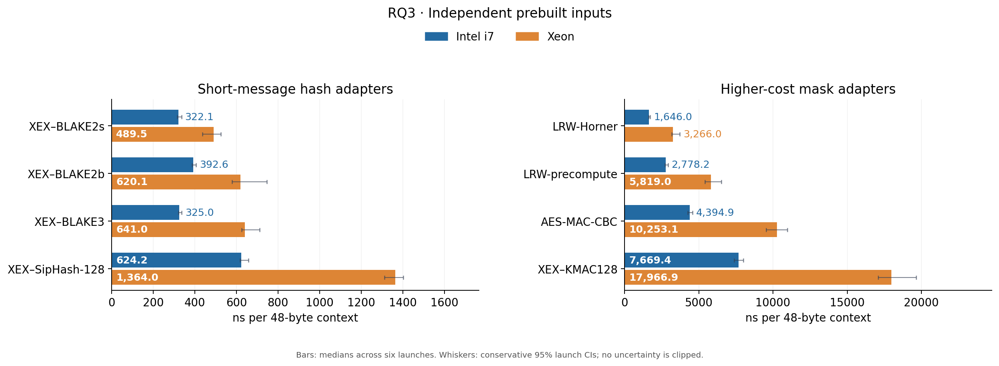](/figures-0/rq3_masks_independent.png)

**Feedback input: mask cost and complete-sector throughput.** Each 48-byte input produces a 16-byte mask; sector throughput refers to the 4 KiB all-profile study.

**Intel i7**

| Mask adapter | ns/call | E MiB/s | D MiB/s |
| --- | --- | --- | --- |
| XEX–BLAKE2s | 340.2 | 6.88 | 32.10 |
| XEX–BLAKE3 | 356.8 | 6.18 | 29.51 |
| XEX–BLAKE2b | 412.8 | 6.63 | 27.89 |
| XEX–SipHash-128 | 633.4 | 5.63 | 18.90 |
| LRW-Horner | 1,684.7 | 4.24 | 8.47 |
| LRW-precompute | 2,825.8 | 4.70 | 10.35 |
| AES-MAC-CBC | 4,422.3 | 4.68 | 257.31 |
| XEX–KMAC128 | 7,664.7 | 1.59 | 2.00 |

**Xeon**

| Mask adapter | ns/call | E MiB/s | D MiB/s |
| --- | --- | --- | --- |
| XEX–BLAKE2s | 535.1 | 3.40 | 19.66 |
| XEX–BLAKE3 | 703.1 | 2.88 | 14.75 |
| XEX–BLAKE2b | 620.2 | 3.35 | 17.42 |
| XEX–SipHash-128 | 1,452.2 | 2.51 | 9.21 |
| LRW-Horner | 3,506.9 | 1.98 | 4.21 |
| LRW-precompute | 5,953.8 | 2.28 | 5.03 |
| AES-MAC-CBC | 10,382.1 | 2.09 | 117.13 |
| XEX–KMAC128 | 18,021.1 | 0.71 | 0.90 |

[CSV: rq3_masks](/figures-0/tables/rq3_masks.csv)

[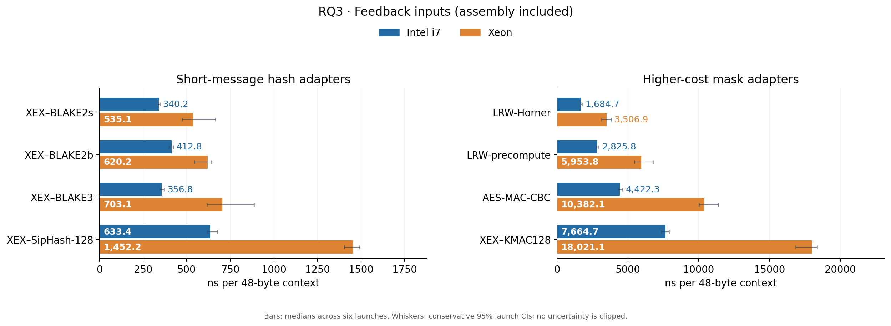](/figures-0/rq3_masks_feedback.png)

[CSV: rq3_hash_comparisons](/figures-0/tables/rq3_hash_comparisons.csv)

**Findings and explanation**

- BLAKE2s is the lowest-cost observed hash adapter on both CPUs: **340 / 535 ns/call**. Relative to KMAC128 it is **22.434 [21.741, 23.478]× / 32.499 [27.597, 37.066]×** faster. This includes API choices: BLAKE2/BLAKE3 copy a pre-keyed state, while KMAC constructs `KMAC128.new(...)` per call. It is not an isolated compression/permutation comparison.
- BLAKE3/BLAKE2b mask-cost ratio is **0.875 [0.835, 0.925]×** on Intel i7 but **1.157 [1.070, 1.380]×** on Xeon. Below 1 favours BLAKE3; above 1 favours BLAKE2b. Both intervals exclude 1, so this adapter ordering genuinely reverses in the measured environments. A 48-byte input cannot exploit BLAKE3's large-input tree parallelism.[^blake3]
- Standalone CBC-MAC runs all three AES stages per context. Complete-sector decryption reuses the seed and batches independent stages. Its apparently poor standalone mask cost and excellent decryption throughput therefore measure different execution schedules.

#### LRW-precompute versus Horner — how much faster?

For a nonzero secret field key $a$, Horner evaluates $((Sa\oplus I_j)a\oplus C_{j-1})a$; precompute uses $Sa^3\oplus I_ja^2\oplus C_{j-1}a$ in $\mathrm{GF}(2^{128})$, modulo $x^{128}+x^7+x^2+x+1$. Position terms/powers are built at key setup; $Sa^3$ is recomputed once per sector call. Work changes from $3n$ general multiplications to $n+1$, plus table lookups/XORs. The two implementations are tested for identical ciphertext.

| Sector bytes | Pass MiB | Op. | Intel i7 speedup [CI] | Xeon speedup [CI] |
| --- | --- | --- | --- | --- |
| 512 | 1 | E | 1.116 [1.106, 1.158]× | 1.089 [1.054, 1.139]× |
| 512 | 1 | D | 1.168 [1.150, 1.185]× | 1.136 [1.017, 1.326]× |
| 512 | 4 | E | 1.110 [1.092, 1.138]× | 1.114 [1.078, 1.215]× |
| 512 | 4 | D | 1.162 [1.161, 1.176]× | 1.136 [1.122, 1.236]× |
| 4096 | 1 | E | 1.124 [1.114, 1.149]× | 1.137 [1.075, 1.183]× |
| 4096 | 1 | D | 1.196 [1.171, 1.236]× | 1.220 [1.161, 1.287]× |
| 4096 | 4 | E | 1.132 [1.117, 1.142]× | 1.105 [1.027, 1.159]× |
| 4096 | 4 | D | 1.208 [1.158, 1.231]× | 1.200 [1.176, 1.361]× |

[CSV: rq3_lrw](/figures-0/tables/rq3_lrw.csv)

[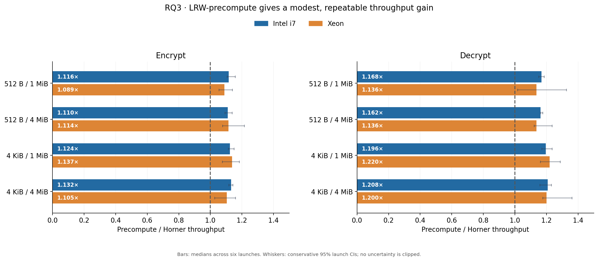](/figures-0/rq3_lrw.png)

**Conclusion:** every listed interval is above 1. The lookup/precompute version gives a **repeatable, modest improvement**, roughly **9–22% at the point estimates**, rather than a threefold runtime improvement. At 4 KiB/4 MiB it improves encryption by **13.2% / 10.5%** and decryption by **20.8% / 20.0%** on Intel i7 / Xeon. Xeon encryption’s lower bound there is only 2.7%, so that case does not guarantee a greater-than-5% practical improvement.

**Trade-off:** engine setup rises from **9.1 to 296.4 µs** on Intel i7 and **16.4 to 557.2 µs** on Xeon, with **4096 bytes** of position payload per engine. Reuse the engine. A standalone precompute call recomputes the sector term and makes separate native field calls; Horner processes three terms in one native call. Sector processing amortizes the sector term, while direct reads pay it anew. That explains why precompute is faster per sector but slower in the standalone mask test and single-block reads.

### RQ4 — Random access, parallelization and recovery

#### Direct reads

Warm ciphertext is already in RAM. Times below are **µs/read** at the indicated one-based block position; all six positions are shown.

**Intel i7**

| Construction | Block 1 | 32 | 64 | 128 | 192 | 256 | Bytes needed at 128 |
| --- | --- | --- | --- | --- | --- | --- | --- |
| AES-ECB | 1.50 | 1.46 | 1.45 | 1.46 | 1.46 | 1.49 | 16 |
| AES-XTS, OpenSSL | 5.06 | 5.08 | 5.04 | 5.06 | 5.11 | 5.12 | 4096 |
| AES-XTS, manual AES-NI | 14.12 | 14.39 | 15.01 | 16.26 | 15.26 | 16.29 | 16 |
| XEX–BLAKE2s | 2.67 | 2.59 | 2.58 | 2.59 | 2.59 | 2.62 | 32 |
| AES-MAC-CBC | 6.52 | 6.44 | 6.45 | 6.42 | 6.45 | 6.43 | 32 |
| LRW-Horner | 4.37 | 4.22 | 4.20 | 4.20 | 4.19 | 4.29 | 32 |
| LRW-precompute | 5.45 | 5.24 | 5.25 | 5.21 | 5.24 | 5.25 | 32 |

**Xeon**

| Construction | Block 1 | 32 | 64 | 128 | 192 | 256 | Bytes needed at 128 |
| --- | --- | --- | --- | --- | --- | --- | --- |
| AES-ECB | 2.84 | 2.79 | 2.79 | 2.80 | 2.81 | 2.82 | 16 |
| AES-XTS, OpenSSL | 8.29 | 8.21 | 8.15 | 8.07 | 8.18 | 8.37 | 4096 |
| AES-XTS, manual AES-NI | 27.57 | 27.93 | 29.02 | 30.51 | 29.40 | 30.95 | 16 |
| XEX–BLAKE2s | 4.73 | 4.66 | 4.64 | 4.68 | 4.65 | 4.76 | 32 |
| AES-MAC-CBC | 12.03 | 11.99 | 11.99 | 11.88 | 12.02 | 11.97 | 32 |
| LRW-Horner | 7.45 | 7.24 | 7.22 | 7.23 | 7.25 | 7.44 | 32 |
| LRW-precompute | 9.56 | 9.17 | 9.39 | 9.18 | 9.21 | 9.27 | 32 |

[CSV: rq4_reads](/figures-0/tables/rq4_reads.csv)

[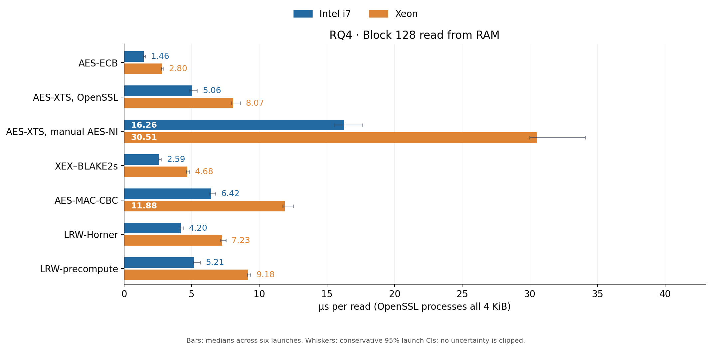](/figures-0/rq4_reads.png)

- Feedback reads require the requested ciphertext and its predecessor, without walking the prefix; block 1 uses the fixed zero predecessor. BLAKE2s reads block 128 in **2.59 / 4.68 µs** on Intel i7 / Xeon. Changing position does not introduce a growing traversal of earlier blocks.
- Manual XTS pays for the Python direct-offset field calculation. The OpenSSL API control decrypts **all 4096 bytes**, so its result is a whole-sector control rather than an optimized native one-block XTS comparison. The bytes column is a logical input requirement, not measured storage traffic.

#### Across-sector threads — absolute throughput, speedup and efficiency

Each cell is **MiB/s (speedup over the same CPU’s one-worker pool)**. Efficiency refers to four workers. † marks a point speedup above 1 whose confidence interval still includes 1; it is not an established gain.

**256 KiB per batch — encrypt**

| CPU | Construction | 1 worker | 2 workers | 4 workers | 4-worker efficiency |
| --- | --- | --- | --- | --- | --- |
| Intel i7 | AES-ECB | 816.26 (1.000×) | 277.06 (0.311×) | 171.92 (0.191×) | 4.77% |
| Intel i7 | AES-XTS, OpenSSL | 563.25 (1.000×) | 154.58 (0.281×) | 146.88 (0.260×) | 6.50% |
| Intel i7 | AES-XTS, manual AES-NI | 55.86 (1.000×) | 36.39 (0.645×) | 28.67 (0.508×) | 12.69% |
| Intel i7 | XEX–BLAKE2s | 6.75 (1.000×) | 1.29 (0.198×) | 1.10 (0.158×) | 3.94% |
| Intel i7 | AES-MAC-CBC | 4.37 (1.000×) | 0.73 (0.165×) | 0.45 (0.105×) | 2.63% |
| Intel i7 | LRW-Horner | 3.90 (1.000×) | 0.68 (0.176×) | 0.49 (0.123×) | 3.08% |
| Intel i7 | LRW-precompute | 4.40 (1.000×) | 0.76 (0.173×) | 0.47 (0.105×) | 2.62% |
| Xeon | AES-ECB | 476.65 (1.000×) | 227.65 (0.500×) | 172.47 (0.330×) | 8.25% |
| Xeon | AES-XTS, OpenSSL | 402.15 (1.000×) | 201.32 (0.548×) | 112.33 (0.350×) | 8.74% |
| Xeon | AES-XTS, manual AES-NI | 25.00 (1.000×) | 23.64 (0.932×) | 18.09 (0.723×) | 18.08% |
| Xeon | XEX–BLAKE2s | 3.53 (1.000×) | 1.49 (0.449×) | 0.75 (0.225×) | 5.63% |
| Xeon | AES-MAC-CBC | 1.68 (1.000×) | 0.82 (0.477×) | 0.45 (0.266×) | 6.64% |
| Xeon | LRW-Horner | 1.89 (1.000×) | 0.88 (0.431×) | 0.43 (0.236×) | 5.90% |
| Xeon | LRW-precompute | 2.11 (1.000×) | 1.00 (0.468×) | 0.45 (0.213×) | 5.33% |

[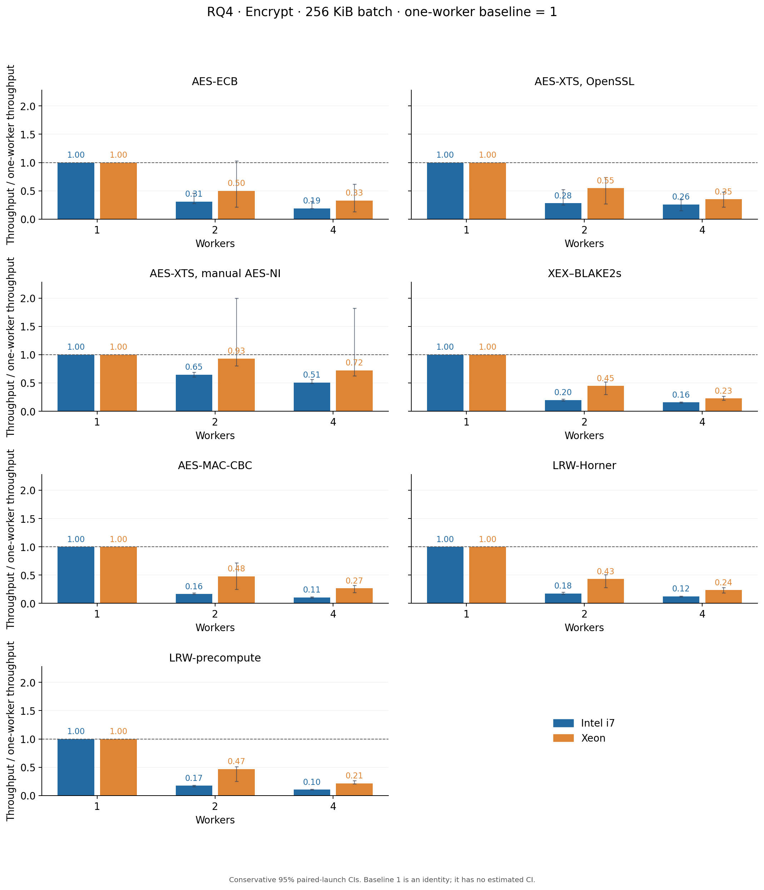](/figures-0/rq4_threads_256_encrypt.png)

**256 KiB per batch — decrypt**

| CPU | Construction | 1 worker | 2 workers | 4 workers | 4-worker efficiency |
| --- | --- | --- | --- | --- | --- |
| Intel i7 | AES-ECB | 970.04 (1.000×) | 257.22 (0.255×) | 197.08 (0.200×) | 5.00% |
| Intel i7 | AES-XTS, OpenSSL | 584.33 (1.000×) | 208.62 (0.378×) | 118.12 (0.243×) | 6.07% |
| Intel i7 | AES-XTS, manual AES-NI | 55.49 (1.000×) | 37.46 (0.683×) | 29.38 (0.536×) | 13.40% |
| Intel i7 | XEX–BLAKE2s | 33.19 (1.000×) | 26.96 (0.822×) | 23.50 (0.711×) | 17.77% |
| Intel i7 | AES-MAC-CBC | 212.56 (1.000×) | 52.53 (0.261×) | 25.36 (0.119×) | 2.97% |
| Intel i7 | LRW-Horner | 8.30 (1.000×) | 1.37 (0.169×) | 0.97 (0.125×) | 3.12% |
| Intel i7 | LRW-precompute | 9.99 (1.000×) | 1.91 (0.200×) | 0.84 (0.086×) | 2.16% |
| Xeon | AES-ECB | 552.39 (1.000×) | 297.32 (0.508×) | 173.98 (0.347×) | 8.67% |
| Xeon | AES-XTS, OpenSSL | 404.76 (1.000×) | 197.12 (0.491×) | 151.20 (0.396×) | 9.91% |
| Xeon | AES-XTS, manual AES-NI | 21.56 (1.000×) | 22.28 (1.051׆) | 17.99 (0.932×) | 23.31% |
| Xeon | XEX–BLAKE2s | 18.48 (1.000×) | 17.11 (0.906×) | 14.61 (0.778×) | 19.45% |
| Xeon | AES-MAC-CBC | 79.30 (1.000×) | 37.19 (0.447×) | 25.41 (0.324×) | 8.09% |
| Xeon | LRW-Horner | 3.69 (1.000×) | 1.88 (0.509×) | 0.92 (0.254×) | 6.36% |
| Xeon | LRW-precompute | 5.05 (1.000×) | 2.37 (0.455×) | 1.02 (0.199×) | 4.97% |

[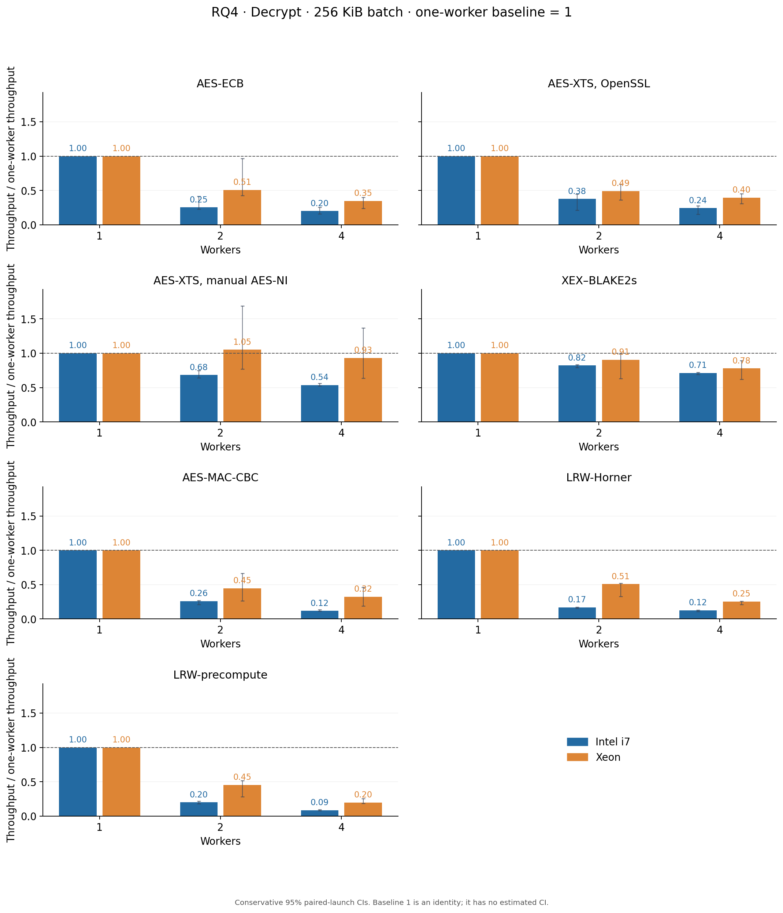](/figures-0/rq4_threads_256_decrypt.png)

**1,024 KiB per batch — encrypt**

| CPU | Construction | 1 worker | 2 workers | 4 workers | 4-worker efficiency |
| --- | --- | --- | --- | --- | --- |
| Intel i7 | AES-ECB | 919.87 (1.000×) | 275.04 (0.279×) | 219.13 (0.227×) | 5.67% |
| Intel i7 | AES-XTS, OpenSSL | 735.21 (1.000×) | 245.15 (0.324×) | 174.38 (0.227×) | 5.67% |
| Intel i7 | AES-XTS, manual AES-NI | 54.58 (1.000×) | 37.84 (0.700×) | 29.02 (0.533×) | 13.33% |
| Intel i7 | XEX–BLAKE2s | 6.14 (1.000×) | 1.15 (0.187×) | 0.97 (0.154×) | 3.84% |
| Intel i7 | AES-MAC-CBC | 4.46 (1.000×) | 0.76 (0.164×) | 0.44 (0.097×) | 2.42% |
| Intel i7 | LRW-Horner | 4.07 (1.000×) | 0.68 (0.171×) | 0.50 (0.120×) | 3.01% |
| Intel i7 | LRW-precompute | 4.51 (1.000×) | 0.76 (0.167×) | 0.46 (0.100×) | 2.49% |
| Xeon | AES-ECB | 615.55 (1.000×) | 273.00 (0.423×) | 179.98 (0.313×) | 7.83% |
| Xeon | AES-XTS, OpenSSL | 457.76 (1.000×) | 193.12 (0.442×) | 156.97 (0.347×) | 8.69% |
| Xeon | AES-XTS, manual AES-NI | 25.78 (1.000×) | 17.45 (0.759×) | 15.38 (0.603×) | 15.08% |
| Xeon | XEX–BLAKE2s | 2.83 (1.000×) | 1.67 (0.528×) | 0.78 (0.268×) | 6.71% |
| Xeon | AES-MAC-CBC | 1.97 (1.000×) | 1.03 (0.539×) | 0.46 (0.238×) | 5.94% |
| Xeon | LRW-Horner | 1.85 (1.000×) | 0.94 (0.485×) | 0.42 (0.224×) | 5.59% |
| Xeon | LRW-precompute | 1.95 (1.000×) | 1.07 (0.531×) | 0.44 (0.224×) | 5.59% |

[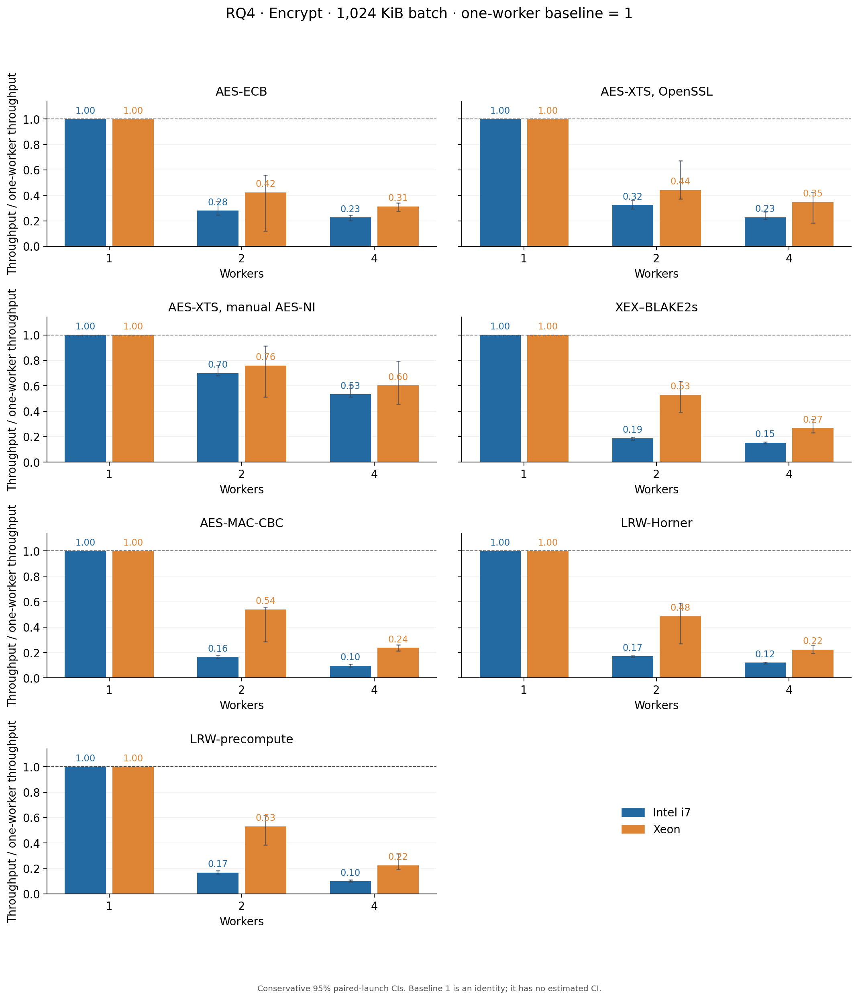](/figures-0/rq4_threads_1024_encrypt.png)

**1,024 KiB per batch — decrypt**

| CPU | Construction | 1 worker | 2 workers | 4 workers | 4-worker efficiency |
| --- | --- | --- | --- | --- | --- |
| Intel i7 | AES-ECB | 1,038.49 (1.000×) | 268.62 (0.255×) | 200.32 (0.207×) | 5.17% |
| Intel i7 | AES-XTS, OpenSSL | 753.07 (1.000×) | 251.95 (0.330×) | 186.69 (0.256×) | 6.39% |
| Intel i7 | AES-XTS, manual AES-NI | 54.40 (1.000×) | 37.38 (0.654×) | 28.71 (0.526×) | 13.15% |
| Intel i7 | XEX–BLAKE2s | 33.85 (1.000×) | 24.96 (0.799×) | 21.85 (0.688×) | 17.21% |
| Intel i7 | AES-MAC-CBC | 234.91 (1.000×) | 53.85 (0.223×) | 26.26 (0.110×) | 2.76% |
| Intel i7 | LRW-Horner | 8.21 (1.000×) | 1.38 (0.166×) | 1.09 (0.131×) | 3.26% |
| Intel i7 | LRW-precompute | 10.10 (1.000×) | 1.80 (0.175×) | 0.86 (0.084×) | 2.11% |
| Xeon | AES-ECB | 673.18 (1.000×) | 243.02 (0.398×) | 232.12 (0.353×) | 8.83% |
| Xeon | AES-XTS, OpenSSL | 469.18 (1.000×) | 237.53 (0.510×) | 149.59 (0.369×) | 9.21% |
| Xeon | AES-XTS, manual AES-NI | 27.92 (1.000×) | 18.78 (0.711×) | 15.14 (0.521×) | 13.02% |
| Xeon | XEX–BLAKE2s | 18.08 (1.000×) | 15.78 (0.881×) | 13.33 (0.758×) | 18.94% |
| Xeon | AES-MAC-CBC | 101.19 (1.000×) | 54.04 (0.562×) | 27.05 (0.260×) | 6.50% |
| Xeon | LRW-Horner | 3.79 (1.000×) | 1.94 (0.513×) | 0.91 (0.237×) | 5.92% |
| Xeon | LRW-precompute | 4.77 (1.000×) | 2.47 (0.499×) | 1.01 (0.212×) | 5.30% |

[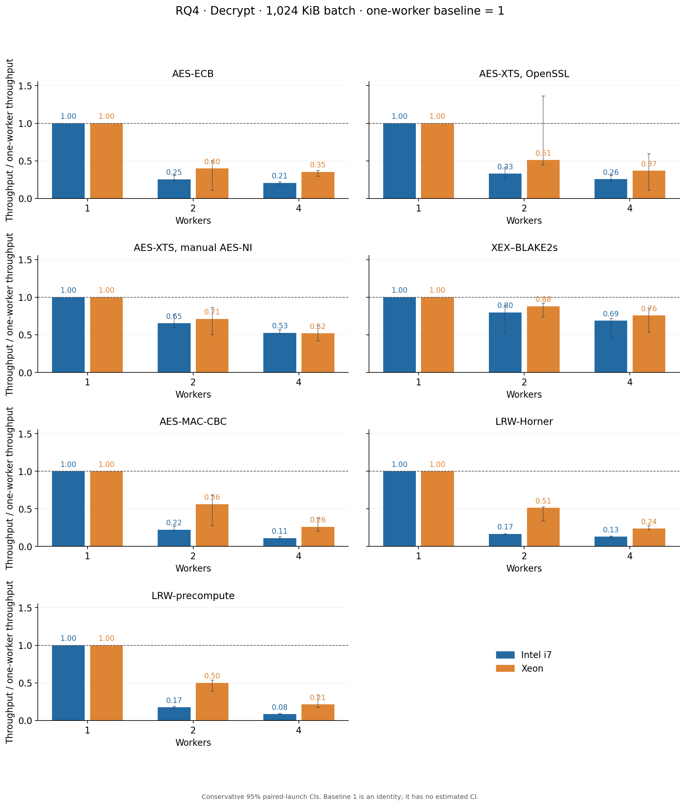](/figures-0/rq4_threads_1024_decrypt.png)

[CSV: rq4_threads](/figures-0/tables/rq4_threads.csv)

**Findings:** at 1 MiB, four workers slow **every** tested construction/direction on both CPUs: all corresponding intervals lie below 1. Across both batch sizes, 56/56 Intel i7 and 50/56 Xeon multiworker intervals establish slowdowns; the other six Xeon cases are inconclusive. No case establishes a gain. CBC-MAC encryption at four workers retains **9.7% / 23.8%** of baseline throughput on Intel i7 / Xeon; four-worker scaling efficiency is approximately **2.4% / 6.0%**. This efficiency measures scaling, not CPU load.

**Explanation:** CPython serializes Python bytecode; the 48-byte BLAKE2 updates also fall below `hashlib`’s greater-than-2047-byte GIL-release threshold. Many small native calls, allocations, synchronization and per-sector dispatch remain. These can outweigh native concurrency; their individual numerical contributions were not isolated. The result concerns this CPython implementation, not whether a compiled implementation can decrypt ranges or independent sectors in parallel.[^gil][^hashlib]

#### Why are some Xeon intervals wide?

Xeon, manual-XTS decryption, 256 KiB: per-launch median throughput and its paired speedups.

| Launch | 1 worker MiB/s | 2 workers | 4 workers | 2/1 speedup | 4/1 speedup |
| --- | --- | --- | --- | --- | --- |
| 1 | 9.98 | 16.86 | 13.66 | 1.690× | 1.368× |
| 2 | 25.71 | 23.91 | 16.83 | 0.930× | 0.654× |
| 3 | 24.51 | 22.98 | 18.95 | 0.938× | 0.773× |
| 4 | 27.98 | 21.57 | 17.85 | 0.771× | 0.638× |
| 5 | 18.62 | 21.67 | 22.18 | 1.164× | 1.191× |
| 6 | 16.60 | 22.88 | 18.12 | 1.379× | 1.092× |

[CSV: rq4_anomaly](/figures-0/tables/rq4_anomaly.csv)

[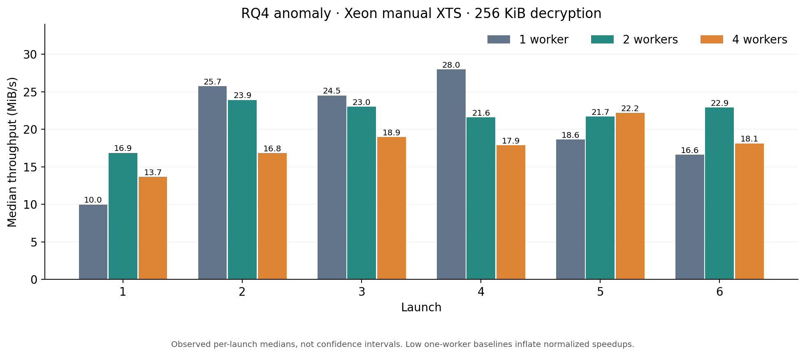](/figures-0/rq4_anomaly.png)

The one-worker baseline ranges from **9.98 to 27.98 MiB/s**. In launch 1, two workers reach 16.86 MiB/s against a low 9.98 baseline, producing 1.690×. In launch 4 the ratio is 0.771×. Their six-launch median is **1.051×**, with conservative 95% interval **[0.771, 1.690]**. The apparent improvement is therefore unresolved. The records identify baseline variation; they do not identify whether frequency, background load or scheduling caused it. Shorter error bars chosen only for Xeon would conceal this uncertainty rather than resolve it.

#### Within-sector decryption

Times are **µs per 4 KiB sector**, including dispatch/joins. OpenSSL’s full-sector API has no offset-range control in this implementation and is excluded from this experiment.

| CPU | Construction | 1 worker µs | 2 workers µs | 4 workers µs | 4/1 speedup [CI] |
| --- | --- | --- | --- | --- | --- |
| Intel i7 | AES-ECB | 43.29 | 169.28 | 322.77 | 0.134 [0.116, 0.153]× |
| Intel i7 | AES-XTS, manual AES-NI | 99.74 | 295.15 | 607.63 | 0.156 [0.145, 0.222]× |
| Intel i7 | XEX–BLAKE2s | 173.21 | 297.62 | 573.28 | 0.299 [0.275, 0.323]× |
| Intel i7 | AES-MAC-CBC | 85.56 | 309.73 | 830.88 | 0.107 [0.080, 0.147]× |
| Intel i7 | LRW-Horner | 653.42 | 3,182.18 | 4,332.60 | 0.151 [0.137, 0.157]× |
| Intel i7 | LRW-precompute | 464.35 | 2,161.25 | 4,685.92 | 0.099 [0.097, 0.121]× |
| Xeon | AES-ECB | 85.20 | 178.73 | 351.45 | 0.211 [0.093, 0.310]× |
| Xeon | AES-XTS, manual AES-NI | 231.37 | 445.90 | 819.77 | 0.277 [0.253, 0.767]× |
| Xeon | XEX–BLAKE2s | 328.23 | 539.44 | 938.25 | 0.425 [0.246, 0.506]× |
| Xeon | AES-MAC-CBC | 124.41 | 416.84 | 818.14 | 0.143 [0.091, 0.174]× |
| Xeon | LRW-Horner | 1,015.94 | 2,414.75 | 4,491.61 | 0.214 [0.156, 0.263]× |
| Xeon | LRW-precompute | 858.47 | 2,037.99 | 4,567.12 | 0.201 [0.166, 0.223]× |

[CSV: rq4_within](/figures-0/tables/rq4_within.csv) · [CSV: rq4_within_ratios](/figures-0/tables/rq4_within_ratios.csv)

[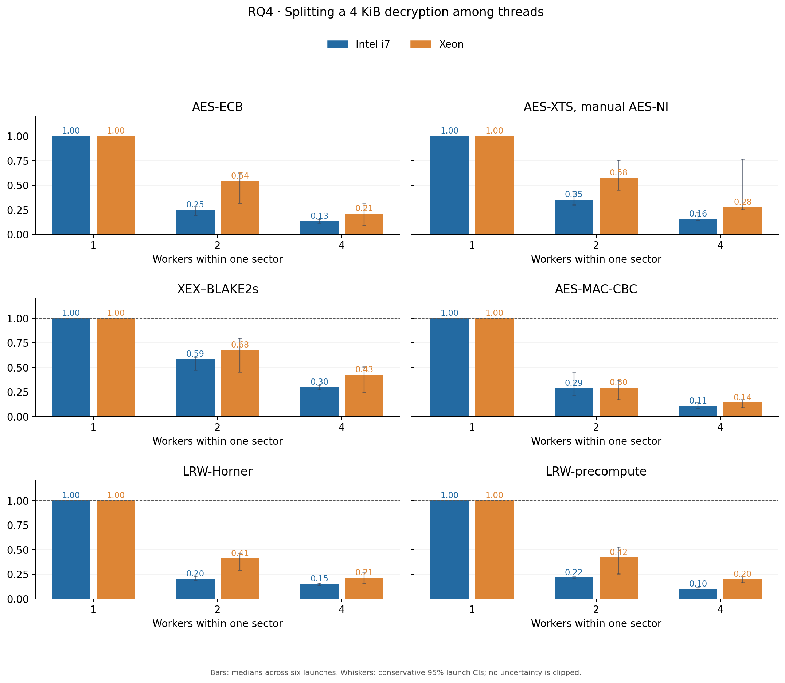](/figures-0/rq4_within.png)

BLAKE2s four-worker speedup is **0.299× [0.275, 0.323]** on Intel i7 and **0.425× [0.246, 0.506]** on Xeon. Correct independent decryption ranges exist, but splitting one small sector does not repay thread overhead in these tests.

#### Ciphertext-error recovery

| Construction | Damage after flip at 1 | at 32 | at 256 | Authenticated detection |
| --- | --- | --- | --- | --- |
| AES-ECB | 1 | 32 | 256 | No |
| AES-XTS, OpenSSL | 1 | 32 | 256 | No |
| AES-XTS, manual AES-NI | 1 | 32 | 256 | No |
| XEX–BLAKE2s | 1, 2 | 32, 33 | 256 | No |
| AES-MAC-CBC | 1, 2 | 32, 33 | 256 | No |
| LRW-Horner | 1, 2 | 32, 33 | 256 | No |
| LRW-precompute | 1, 2 | 32, 33 | 256 | No |

[CSV: rq4_recovery](/figures-0/tables/rq4_recovery.csv)

Both CPUs and every launch agree. Feedback corruption at block 32 damages plaintext blocks 32–33, then recovers at 34; ECB/XTS affect only block 32. This design uses one preceding ciphertext block, so an isolated error does not corrupt the entire suffix. This trace demonstrates functional error behavior, not authentication or a security proof.

#### What changes across environments?

- In the single-threaded 4 KiB throughput tables, Intel i7 is **1.60–2.25×** faster across construction/direction point estimates. The BLAKE3/BLAKE2b mask ordering reverses; the severity of thread slowdowns also changes. Environment effects are therefore noticeable both in absolute speed and some relative rankings.
- The stable conclusions are the OpenSSL XTS advantage, the large benefit of feedback decryption batching, the modest LRW-precompute gain, and the absence of an established thread gain. CPU, Python, binary dispatch, OS/virtualization and scheduling changed together, so their separate causal contributions cannot be assigned from these two hosts.

## 5. Further considerations

- Move the complete feedback loops and batched mask operations into native code while retaining Python as the experiment/plot driver; preserve byte-for-byte reference outputs. Measure the remaining algorithmic cost after reducing wrapper overhead.
- Test native workers or processes with larger chunks per worker, equal total bytes and controlled affinity. More CPython threads alone are not supported by the current results.
- For narrow confidence intervals or close hash rankings, control power/load and add independent launches across time periods. Adding dependent operations within one launch does not resolve between-launch instability.
- Isolate environment variables on the same machine, such as interpreter version or acceleration settings. Keep source hashes, package versions, seeds and all per-launch records.

[^stats]: [NIST Technical Note 2119](https://nvlpubs.nist.gov/nistpubs/TechnicalNotes/NIST.TN.2119.pdf), distribution-free quantile confidence intervals. [Kalibera and Jones (2013)](https://kar.kent.ac.uk/33611/45/p63-kaliber.pdf) explain why systems benchmarks must retain variation between executions and report uncertainty in speedups.
[^aes]: [PyCryptodome AES documentation](https://www.pycryptodome.org/src/cipher/aes), hardware acceleration selection.
[^openssl]: [OpenSSL AES-NI source](https://github.com/openssl/openssl/blob/master/crypto/aes/asm/aesni-x86_64.pl), interleaved XTS implementation; the exact dispatched routine was not traced here.
[^blake3]: [BLAKE3 designers' specification](https://github.com/BLAKE3-team/BLAKE3-specs/blob/master/blake3.tex), short inputs and tree parallelism.
[^gil]: [Python threading documentation](https://docs.python.org/3.14/library/threading.html), GIL and CPU-bound threading.
[^hashlib]: [Python hashlib documentation](https://docs.python.org/3.14/library/hashlib.html), GIL-release threshold.
