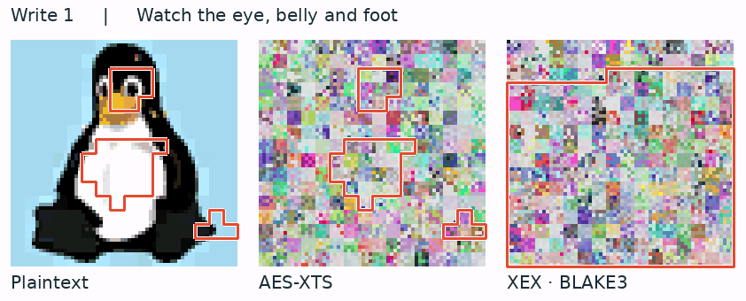
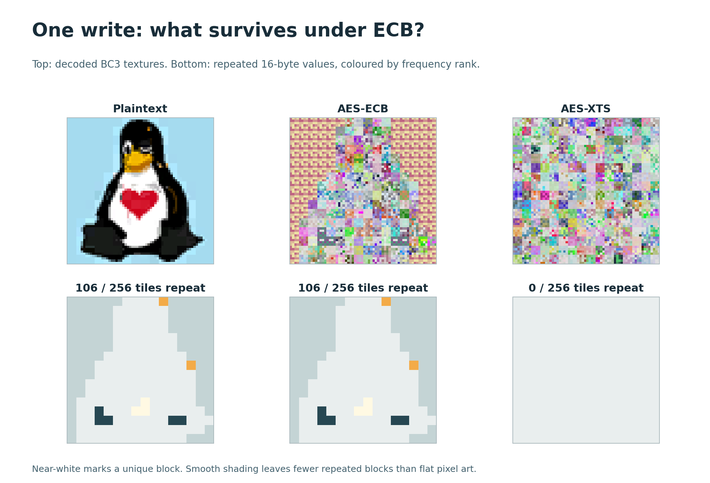
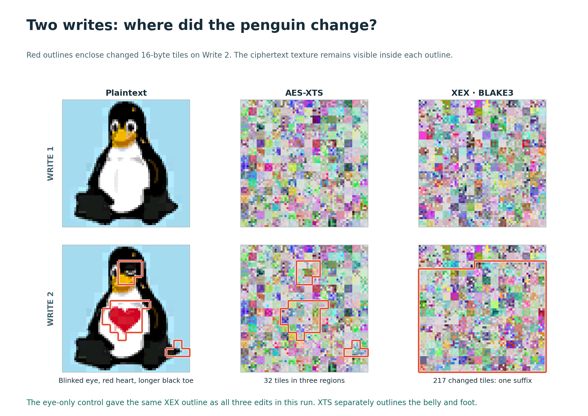
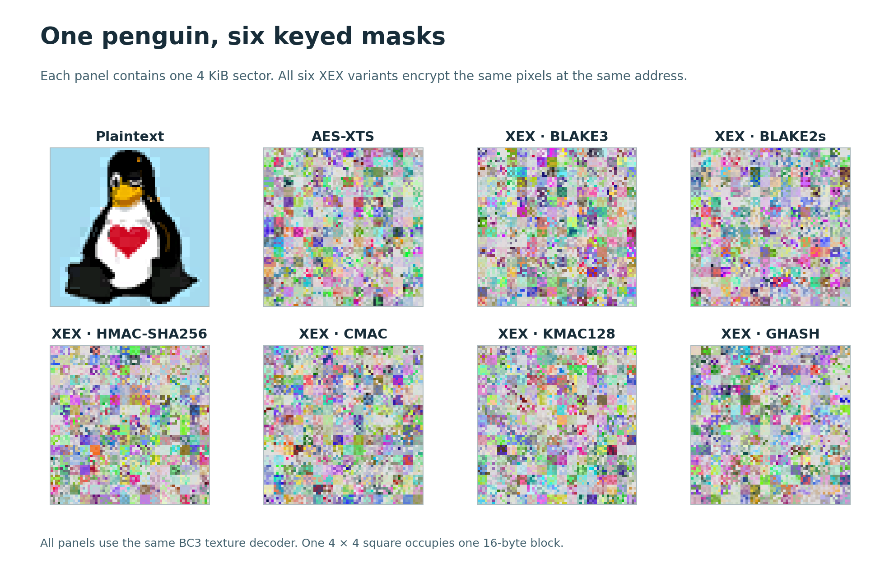

# What do two encrypted snapshots of a penguin reveal?

This experiment adapts the seated Tux illustration, using the Inkscape vector rendition of Larry Ewing’s penguin (lewing@isc.tamu.edu), originally drawn with the GIMP. The feet have been darkened and the right eye, belly and toe are edited on write 2. The penguin is a **64 × 64 BC3 (DXT5) texture**. In this graphics format, one 4 × 4 square of pixels occupies exactly 16 encoded bytes: **one square = one AES block**. There are 16 squares per row, 16 rows, and 4,096 bytes in total. The red outlines trace blocks whose 16 bytes actually changed.



## 1. Method: from a sector to a picture

1. Encode each version as a [BC3 texture](https://learn.microsoft.com/en-us/windows/win32/direct3d10/d3d10-graphics-programming-guide-resources-block-compression). Place the 4 KiB texture payload at the start of sector 37; the 128-byte DDS header is viewing metadata, outside the simulated sector. This models an aligned texture payload, not an arbitrary DDS file copied to disk.
2. Encrypt the **stored bytes in order**, reusing the same address and keys for both writes. Block $j$ (zero-based) contains bytes $16j$ through $16j+15$ and starts at pixel $(4(j\bmod16),4\lfloor j/16\rfloor)$. No extra padding, Hilbert traversal or encryption of individual pixels is needed.
3. Put the same header on each ciphertext payload and decode it as BC3. All panels use the same decoder and grey background for transparency. The comparison uses **all 16 ciphertext bytes**, never a pixel colour or a visual estimate. Red lines follow only the outer edges of the changed tiles. The GIF uses a fixed palette and outlines on both frames.

## 2. Equality and longest common prefix

For two writes $P,Q$ of $n$ blocks, their longest common prefix is

$$
\operatorname{LCP}(P,Q)=\max\{k\in\{0,\ldots,n\}: P_i=Q_i\ \text{for all}\ 0\le i<k\}.
$$

| Mode | What ciphertext equality tells us |
|---|---|
| AES-ECB | Equal plaintext blocks encrypt identically wherever they occur under the key. A single snapshot can reveal a silhouette. |
| AES-XTS | At the **same sector and position** under the same keys, ciphertext is equal across writes exactly when plaintext is equal. Comparing snapshots locates every edited block. |
| XEX ratchet | The ciphertext and plaintext have the same LCP. Identical prefixes give identical masks; at the first edit, encryption under the same mask is a permutation, so ciphertext differs. The changed predecessor can then change the next mask even when the next plaintext is unchanged. |

## 3. Results

**One snapshot.** Of 256 blocks, **106** belong to repeated values in both the plaintext and ECB, versus **255** in the flat pixel-art comparison. The solid blue background still outlines Tux in ECB; the shaded face and heart are harder to recognise. XTS produced 256 distinct blocks. Blocks coloured near-white in the equality views occur only once.



**Two snapshots.** We blinked one eye (8 tiles), added a red heart on the belly (20), and extended the black right toe (4). XTS flagged exactly these 32 tiles. With each of the six XEX masks, the first **39 blocks** stayed unchanged and all **217 remaining blocks** differed. Editing the eye alone gave the same XEX outline, so that outline cannot establish whether the belly or foot was edited. Equality of the LCP is exact; the uninterrupted changed suffix is a measured result for this fixture, not a security proof.



**Mask control.** These six views change only the keyed mask function: BLAKE3, BLAKE2s, HMAC-SHA256, AES-CMAC, KMAC128 and GHASH. Each uses the same AES data key and the same input layout: 16-byte sector number, 16-byte block index, and previous 16-byte ciphertext (zero at the start). Similar pictures do not establish equivalent security.



## Reproduce

From the extracted project directory:

```sh
python -m pip install -r requirements.txt
python -m unittest discover -s tests -v
python run.py
```

The run verifies decryption, compares full blocks, and checks that visible changes in the saved GIF match the measured block sets. See [one-write counts](evidence/one-write.csv), [two-write block indices](evidence/two-writes.csv), or the [DDS files and their PNG previews](rasters/). All keys are public demonstration fixtures. The included SVG and its 768-pixel-high raster are the illustration source, not the encryption input. The generator antialiases the artwork to 64 × 64 before BC3 encoding. More visual detail therefore requires no additional sector bytes. Source: Inkscape, `share/branding/tux.svg`; [original Tux and credit](https://isc.tamu.edu/~lewing/linux/).
